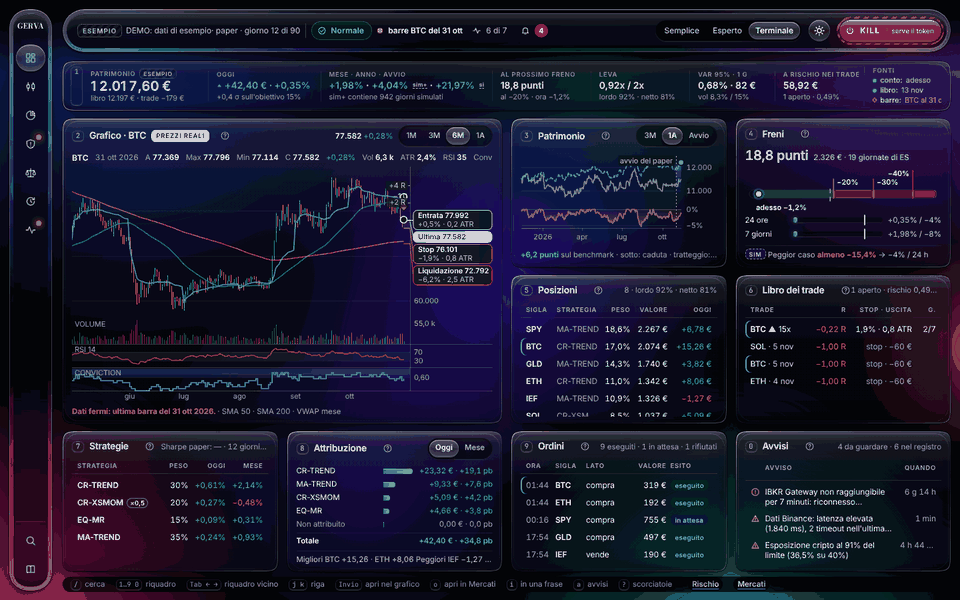
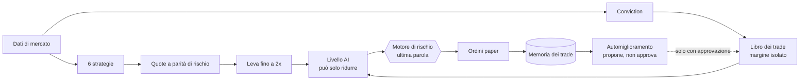
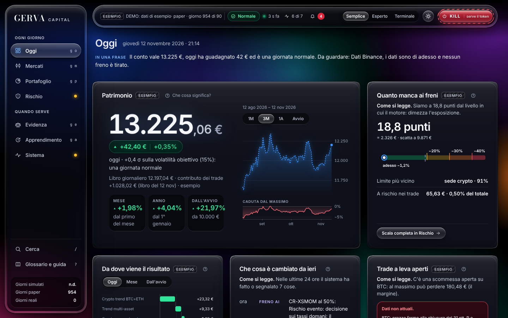
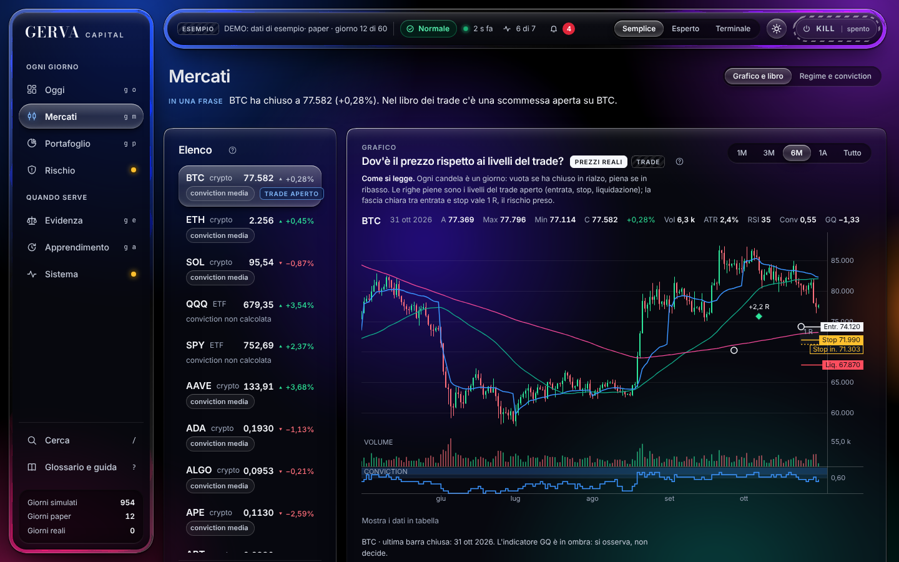
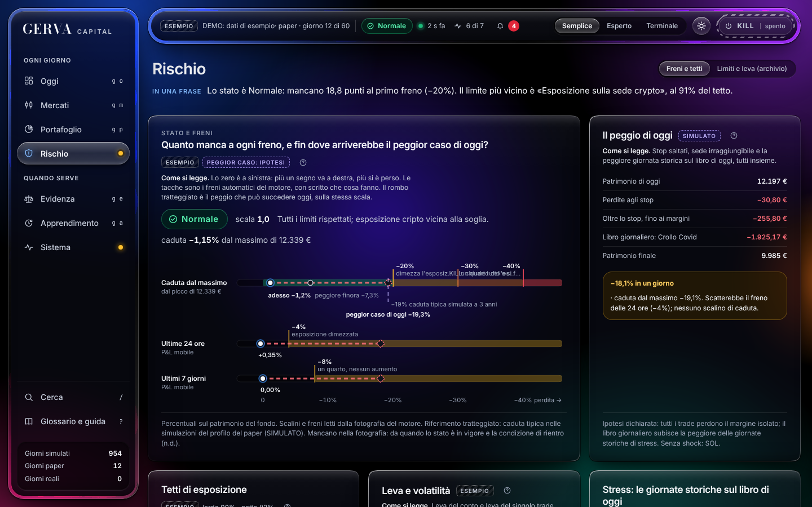
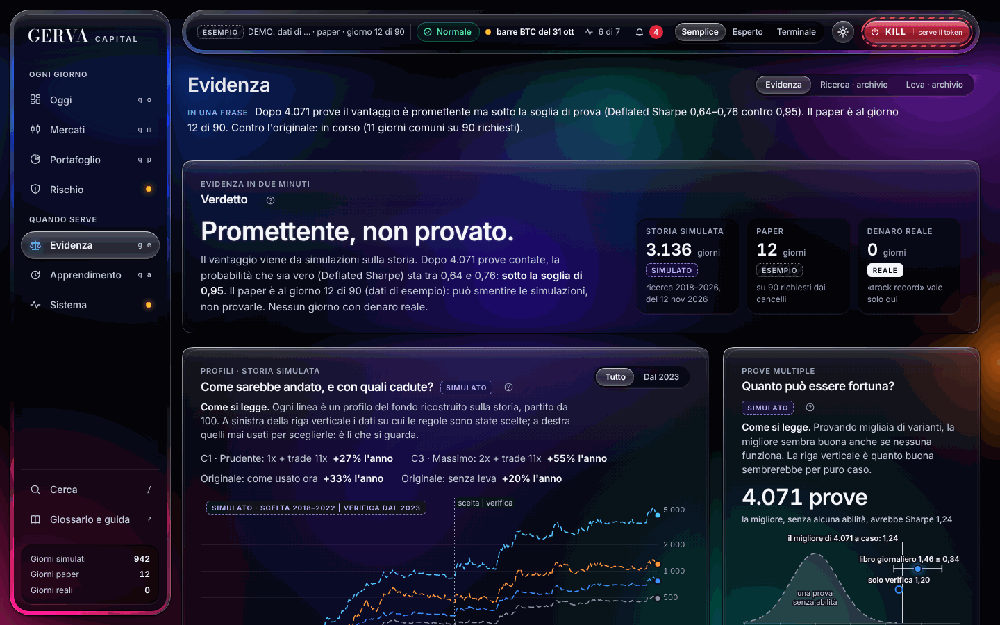
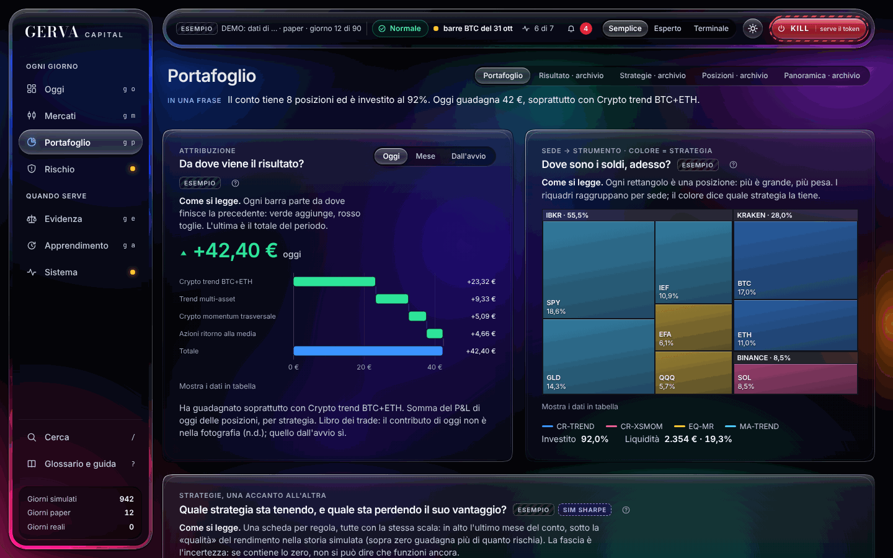
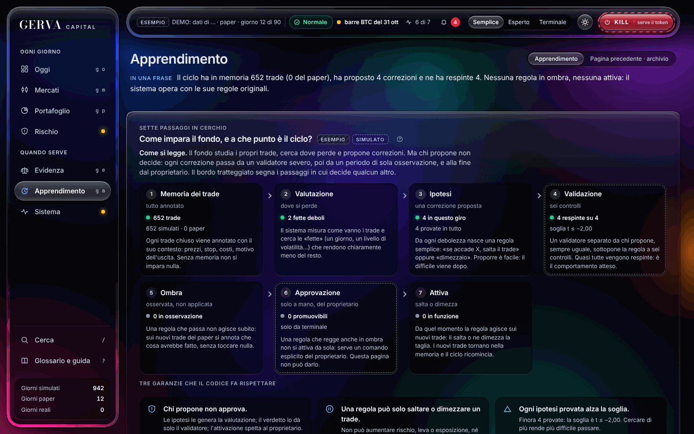
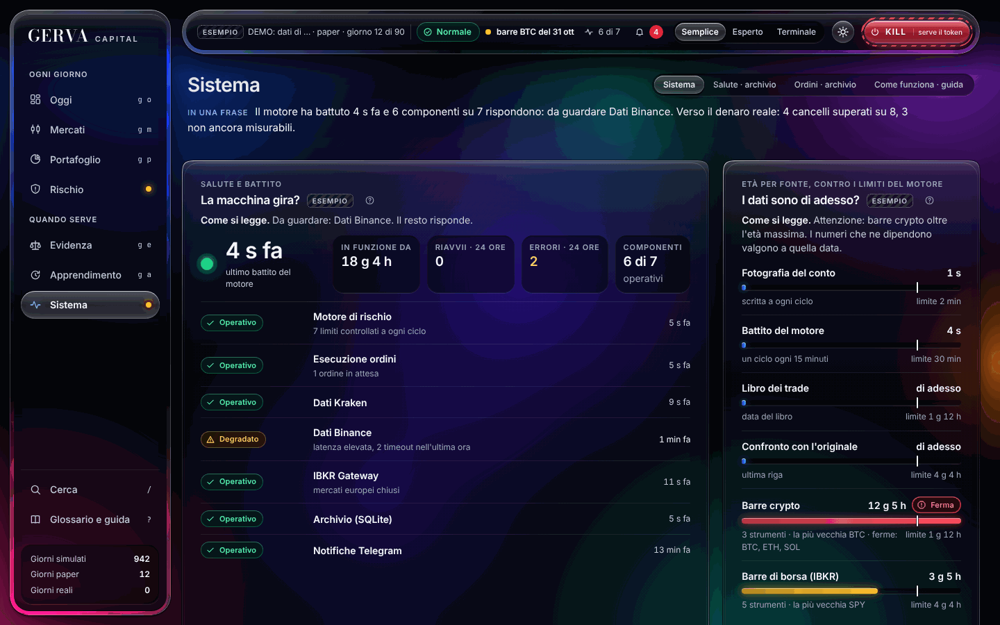

<div align="center">

# GERVA Capital

**Un fondo sistematico personale: sei regole di trading, un motore di rischio che decide per ultimo, e un terminale per vedere tutto.**

[](VERSION)
[](https://github.com/Andrea-Gervasoni/GERVA-Capital/actions/workflows/test.yml)




*Il terminale, con dati di esempio. Nessun numero di questa animazione è un risultato reale.*

[In breve](#in-breve) · [Risultati](#risultati) · [Come funziona](#come-funziona) · [Avvio rapido](#avvio-rapido) · [Il terminale](#il-terminale) · [Ricerca](#ricerca-e-riproducibilità) · [Limiti](#limiti-dichiarati) · [Struttura](#struttura-del-repository)

</div>

---

## In breve

GERVA Capital decide ogni 15 minuti quanto tenere in crypto, indici azionari ed ETF, seguendo regole fisse verificate su dati reali. Un livello di agenti AI può solo frenarlo; un motore di rischio deterministico può fermarlo del tutto; un ciclo di automiglioramento studia i trade chiusi e propone correzioni che possono solo ridurre il rischio.

> [!IMPORTANT]
> **Tutti i rendimenti di questa pagina sono simulati su dati storici.** Il sistema gira oggi solo in paper trading, senza denaro reale e senza ordini verso un broker. Niente qui è una promessa di rendimento o un consiglio di investimento.

| | |
|---|---|
| **Che cosa negozia** | Bitcoin, Ether e le crypto più scambiate; S&P 500 e Nasdaq; 17 ETF su azioni, obbligazioni, oro, materie prime |
| **Come decide** | Sei strategie giornaliere poco correlate, più un libro di trade a margine isolato nei giorni ad alta "conviction" |
| **Chi ha l'ultima parola** | Il motore di rischio: scalini di caduta, perdita di giornata e di settimana, arresto di emergenza |
| **Quanto è stato messo alla prova** | 4.071 varianti provate e tutte contate; oltre 500 test automatici; periodo di verifica dal 2023 mai usato per scegliere |

## Risultati

Simulazione 2018–2026 con il motore di rischio dentro, costi per sede e finanziamento della leva. Dettaglio in [`docs/RIFONDAZIONE.md`](docs/RIFONDAZIONE.md) e [`docs/PAPER.md`](docs/PAPER.md).

| Profilo (SIMULATO) | Rendimento annuo | Sharpe | Caduta massima |
|---|---:|---:|---:|
| **Profilo del paper**: libro giornaliero fino a 2x + trade a rischio 0,5% / 1% | **39,5%** (37,8% dal 2023) | **1,27** | **−21%** |
| Libro giornaliero a 2x | 27,7% | 1,47 | −18% |
| Sistema originale, senza leva (ricostruito con le stesse convenzioni) | 20,3% | 0,96 | −18% |
| Sistema originale, com'è usato (leva 150%) | 33,5% | 0,85 | −37% |

Tre cose che un lettore attento deve sapere, e che qui non sono nascoste:

- **Promettente, non provato.** Contando tutte le 4.071 varianti provate, il Deflated Sharpe è tra 0,64 e 0,76, sotto la soglia di 0,95. Lo scenario centrale dimezza il vantaggio misurato: circa 1–2% al mese.
- **Il rendimento in più rispetto al libro senza leva viene da più rischio, non da più abilità.** Lo Sharpe scende quando si aggiungono leva e trade.
- **Il profilo del paper è stato simulato prima dell'ultima modifica** (trend lento ribilanciato ogni mese): i numeri sopra non sono stati ricalcolati.

<details>
<summary><b>Che cosa è stato provato e scartato</b></summary>

GEX e VWAP come segnali di direzione, momentum e ritorno alla media intraday, rotture a stop stretto, arbitraggio statistico tra coppie, market making e alta frequenza su dati veri di book, vendita di volatilità, carry sul funding, liquidazioni e open interest, segnali on-chain e di sentiment, modelli statistici per scegliere i trade, gestione attiva del trade (piramidare, uscite parziali), ETP a leva 3x–5x, futures su 37 mercati, azioni singole, copia dei trader migliori, leva per trade a 30x e 50x. Ognuno con i suoi numeri in [`research/v5/`](research/v5/).

</details>

## Come funziona



| Parte | Che cosa fa | Dove |
|---|---|---|
| Strategie | Trend su BTC ed ETH, momentum tra 20 crypto, ritorno alla media su S&P 500 e Nasdaq, trend lento su 17 ETF | [`gerva/strategies/book.py`](gerva/strategies/book.py) |
| Libro dei trade | Trade a circa 11x (mai oltre 15x) con perdita massima fissata prima di entrare | [`gerva/risk/isolated.py`](gerva/risk/isolated.py) |
| Motore di rischio | A −20% dimezza, a −30% riduce a un quarto, a −40% chiude tutto e resta fermo | [`gerva/risk/engine.py`](gerva/risk/engine.py) |
| Livello AI | Legge notizie e comunicati; due modelli devono concordare e citare la fonte; possono solo frenare | [`gerva/ai/`](gerva/ai/) |
| Automiglioramento | Cerca dove il sistema perde, propone regole, le fa validare da codice indipendente | [`gerva/learn/`](gerva/learn/) |
| Indicatore Gervasoni | Qualità del trend, in ombra: si misura, non decide | [`gerva/gervasoni.py`](gerva/gervasoni.py) |

Le garanzie fatte rispettare dal codice, ciascuna con un test:

- nessun agente AI può aumentare esposizione, leva o rischio, né toccare i limiti;
- una correzione appresa può solo saltare o dimezzare un trade, e si attiva solo con un comando del proprietario;
- ogni ordine è registrato prima di partire e non può essere duplicato;
- backtest e ciclo dal vivo usano le stesse funzioni;
- l'arresto di emergenza chiude tutto, compresi i trade a leva, e si riaccende solo a mano.

## Avvio rapido

```bash
git clone https://github.com/Andrea-Gervasoni/GERVA-Capital.git
cd GERVA-Capital
bash deploy/avvia_paper.sh
```

Lo script crea l'ambiente Python, avvia il ciclo paper, i passi giornalieri e il terminale su `http://127.0.0.1:8787`. Nessun ordine reale: il codice accetta solo le modalità `paper` e `alpaca-paper`.

| Comando | Che cosa fa |
|---|---|
| `python -m gerva status` | Stato del rischio, patrimonio, posizioni |
| `python -m gerva gates` | I cancelli numerici tra paper e denaro reale |
| `python -m gerva learn` | Un giro del ciclo di automiglioramento |
| `python -m gerva research` | Rifà i backtest sui dati reali aggiornati |
| `python -m gerva kill --reason "..."` | Arresto di emergenza |
| `python -m pytest` | Tutti i test |

Guida completa: [`docs/PAPER.md`](docs/PAPER.md). Con Docker: `docker compose -f deploy/docker-compose.gerva.yml up -d --build`.

## Il terminale

Sette spazi, tre livelli di lettura (Semplice, Esperto, Terminale), nessuna libreria esterna. È in sola lettura: l'unico comando che scrive è l'arresto di emergenza, protetto da token.

<details open>
<summary><b>Oggi</b>: il patrimonio, la distanza dai freni, da dove viene il risultato</summary>



</details>

<details>
<summary><b>Mercati</b>: candele con gli indicatori del fondo e i livelli del trade</summary>



</details>

<details>
<summary><b>Rischio</b>: una sola scala con tutti i freni, il peggior caso di oggi, le giornate di stress</summary>



</details>

<details>
<summary><b>Evidenza</b>: quanto del risultato può essere fortuna, e il confronto con il sistema originale</summary>



</details>

<details>
<summary><b>Portafoglio, Apprendimento, Sistema</b></summary>





</details>

Le schermate usano dati di esempio, etichettati come tali nel terminale stesso.

## Ricerca e riproducibilità

- **Dati reali e pubblici:** archivio Binance, Hyperliquid, Yahoo, FRED, Deribit, SqueezeMetrics.
- **Scelta e verifica separate:** i parametri si scelgono fino al 31 dicembre 2022; il periodo dal 2023 serve solo a verificare.
- **Costi dichiarati:** per sede, con finanziamento della leva; ogni strategia è riprovata a costi doppi e con un giorno di ritardo.
- **Tutte le prove contate:** 4.071, compresi i fallimenti. Lo Sharpe atteso dal migliore di 4.071 tentativi senza alcuna abilità è 1,24.
- **Script e uscite nel repository:** ogni tabella del documento ha il suo script in [`research/v5/`](research/v5/).

| Documento | Contenuto |
|---|---|
| [`docs/RIFONDAZIONE.md`](docs/RIFONDAZIONE.md) | Il documento completo: strategie, portafoglio, leva, validazione, sedi, struttura, AI, roadmap |
| [`docs/COME_FUNZIONA.md`](docs/COME_FUNZIONA.md) | Il fondo in due pagine, e il confronto con il sistema originale |
| [`docs/PAPER.md`](docs/PAPER.md) | Profilo scelto, avvio, cancelli |
| [`research/v5/v4/RISULTATI.md`](research/v5/v4/RISULTATI.md) | 680 varianti in sette famiglie |
| [`research/v5/v4/STRUTTURA.md`](research/v5/v4/STRUTTURA.md) | Sedi, custodia, veicolo giuridico e fiscale, con 50 fonti |

## Limiti dichiarati

- Nessun giorno di operatività con denaro reale; il paper è appena iniziato.
- Mancano gli adattatori per operare su una sede vera (Kraken, Hyperliquid, Interactive Brokers).
- Il libro dei trade a leva lavora su barre giornaliere e su un registro interno: misura la regola, non l'esecuzione.
- Gli ETF del trend lento sono americani: un residente europeo al dettaglio dovrà sostituirli con equivalenti UCITS.
- Le simulazioni del libro dei trade usano in parte prezzi spot al posto dei perpetual.

## Struttura del repository

```
gerva/        il motore: dati, strategie, rischio, esecuzione paper, AI, automiglioramento
dashboard/    il terminale (FastAPI in sola lettura + HTML, CSS, JavaScript scritti a mano)
research/     script, uscite e dati della ricerca, tornata per tornata
docs/         documento di rifondazione, guide, schermate
deploy/       avvio su Mac, Linux e Docker
tests/        oltre 500 test
firm/ quantlab/ portal/   il sistema originale, conservato e funzionante
```

Il sistema originale è documentato in [`docs/LEGACY.md`](docs/LEGACY.md). I due sistemi girano affiancati e si confrontano con [`research/v5/v6/b8_confronto/confronto.py`](research/v5/v6/b8_confronto/confronto.py).

---

<div align="center">
<sub>GERVA Capital · progetto personale di ricerca · non è un'offerta al pubblico né un consiglio di investimento</sub>
</div>
