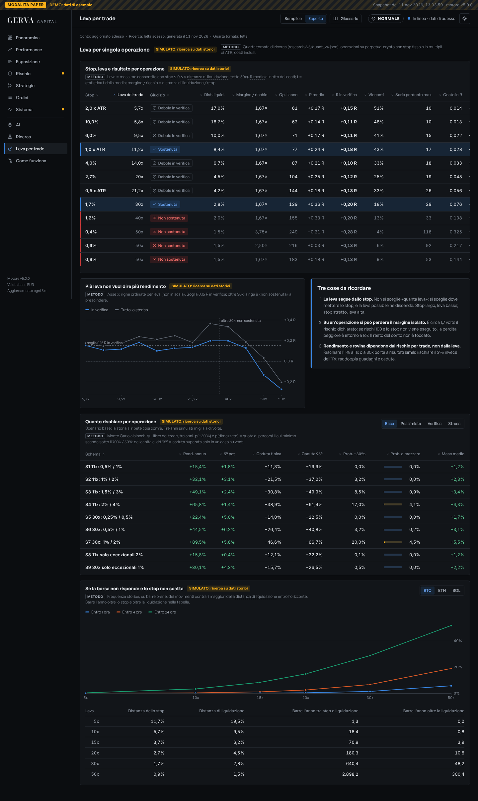
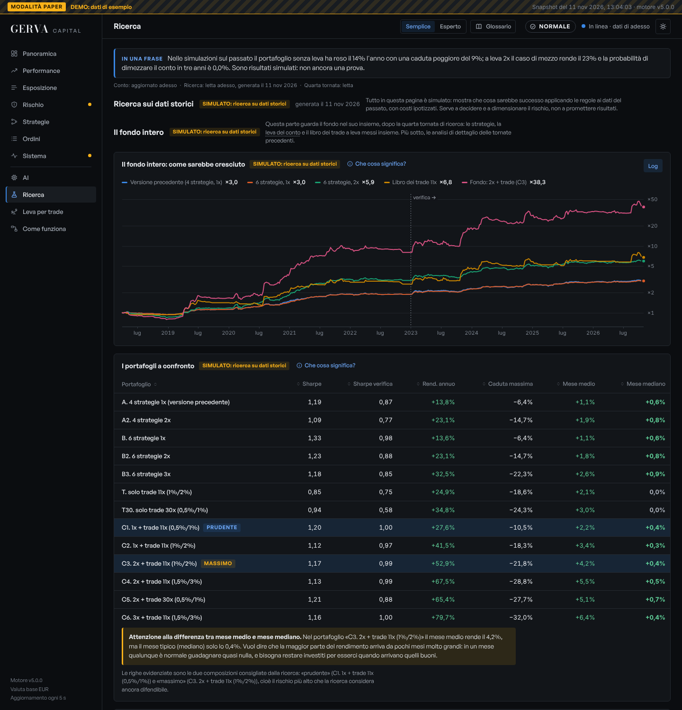
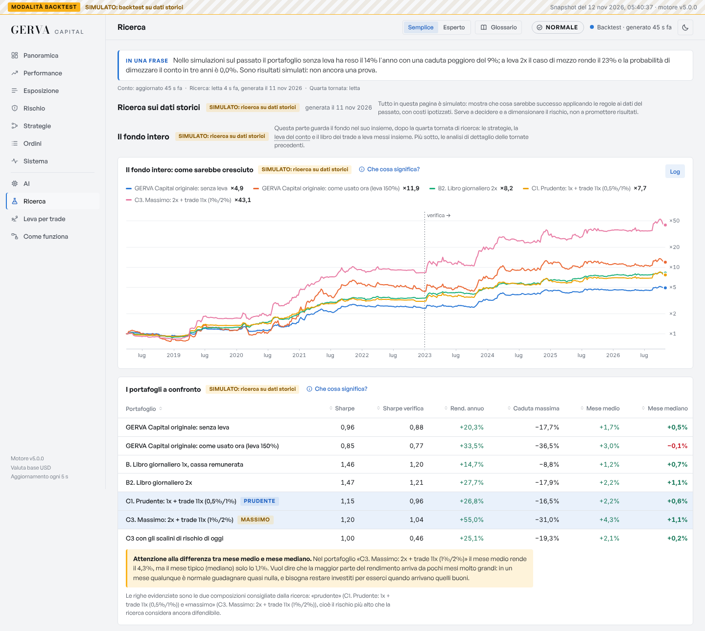
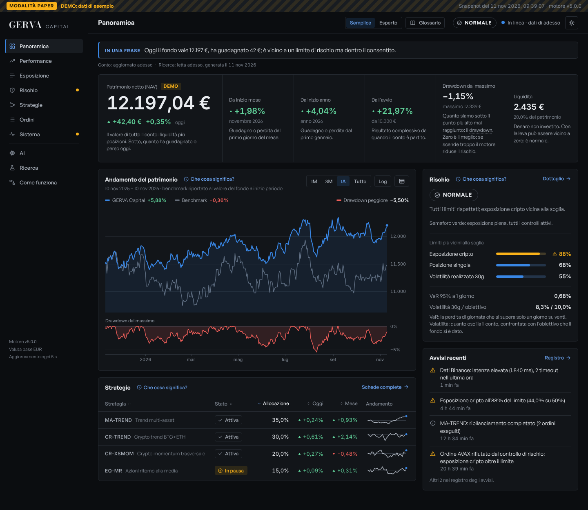
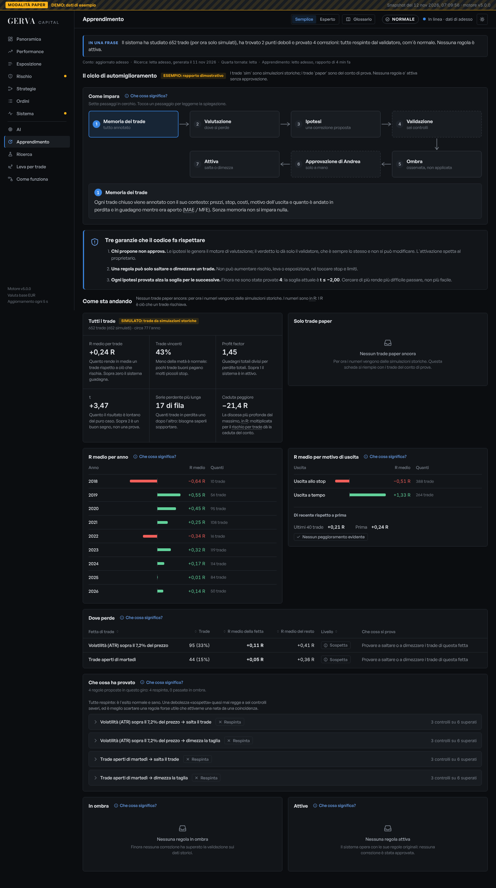

# GERVA Capital — Rifondazione, versione 3

**11 novembre 2026.** Tutti i rendimenti di questo documento sono **SIMULATI** su dati storici reali. Il fondo non ha un solo giorno di operatività, nemmeno in paper. Le etichette: **[F]** fatto verificato (dato o fonte letta), **[S]** stima, **[I]** ipotesi.

La versione precedente è in [`archivio_RIFONDAZIONE_v2.md`](archivio_RIFONDAZIONE_v2.md). I dettagli di questa versione stanno in tre file che il documento riassume:

- [`research/v5/v4/RISULTATI.md`](../research/v5/v4/RISULTATI.md): le strategie provate nella quarta tornata, con script, uscite e fonti;
- [`research/v5/v4/STRUTTURA.md`](../research/v5/v4/STRUTTURA.md): sedi, custodia, veicolo giuridico e fiscale, infrastruttura, sicurezza, con 50 fonti;
- `research/v5/v4/leva_trade_*.py` e `09_fondo.py`: la leva per singolo trade e il fondo intero.

---

## 0. Che cosa è cambiato rispetto alla versione 2

| Tema | Versione 2 | Versione 3 |
|---|---|---|
| **Strategie** | 4 strategie giornaliere; 122 varianti provate | 6 strategie giornaliere più un libro di trade a leva; **812 varianti** provate in tutto, di cui 680 nuove in sette famiglie |
| **Leva** | Tetto 2x sul conto; leva per trade solo progettata | **Libro dei trade a margine isolato**, misurato sul percorso a 5 minuti: 11x sui setup confermati, 30x sugli eccezionali, 50x respinta dai dati. Il tetto 2x resta solo sul libro giornaliero |
| **Rendimento atteso** | 23% l'anno (base), 10% (prudente) | Profilo prudente **28% / 15%**; profilo massimo **55% / 22%** (base / prudente) |
| **Rischio** | Caduta tipica −17% | Prudente −9%; massimo −19% tipica, −35% nel 5% dei casi peggiori |
| **Sedi** | IBKR, exchange UE, Alpaca paper | Verificato che cosa è lecito per un residente italiano: perpetual a 10x su sedi MiFID; Binance chiusa; Hyperliquid solo come quota a perdere |
| **Struttura** | Persona fisica, indicazioni generali | Veicolo, fisco (33% / 26%), custodia, costi mensili, domande per commercialista e avvocato |
| **AI** | Può ridurre o vietare le strategie | In più: moltiplicatore sul rischio del singolo trade, sempre tra 0 e 1 |
| **Evidenza statistica** | Deflated Sharpe 0,51 su 110 prove | **0,38 su 812 prove** (0,20 per il vecchio portafoglio): contare tutte le prove ha abbassato la fiducia, non alzata |

**Aggiornamento, quinta e sesta tornata.** Diciotto analisti hanno rivisto tutto e cercato in classi nuove (sezioni 11 e 12). Hanno corretto i profili di questa versione in entrambe le direzioni, ritirato il livello a 30x e misurato il fondo contro il GERVA Capital originale. **Dove le sezioni 11–12 e le sezioni 1–3 divergono, valgono le sezioni 11–12; il riepilogo in fondo è aggiornato.**

**Un errore mio corretto in questa versione.** La prima misura del fondo combinato dava uno Sharpe di 1,50. Era gonfiata: attribuivo l'intero guadagno di un trade al giorno di uscita, e la correlazione giornaliera con il resto del portafoglio risultava 0,16 invece di 0,64. Sui rendimenti mensili lo Sharpe è 1,17. Tutti i numeri del fondo combinato qui sotto sono mensili.

---

## Verdetto

1. **Il 20–30% al mese resta non sostenuto.** Il profilo più spinto che i dati reggono rende in media il 3,7% al mese nello scenario base e l'1,7% in quello prudente. Mesi sopra il 20% capitano (il 12% dei mesi nella simulazione), ma insieme a mesi da −17%.
2. **La leva alta sul singolo trade è sostenibile fino a 30x**, a una condizione: che il rischio per trade resti tra lo 0,5% e il 2% del patrimonio. A margine isolato la leva decide quanto margine impegni, non quanto perdi.
3. **Il rendimento in più non viene da nuova abilità.** Lo Sharpe del portafoglio giornaliero è 1,34; quello del fondo con il libro dei trade è 1,17. Si guadagna di più perché si rischia di più, in modo controllato.
4. **Le strategie "da hedge fund" cercate non reggono per un conto al dettaglio**: arbitraggio statistico, market making, vendita di volatilità, intraday con GEX e VWAP perdono dopo i costi. Reggono il carry su Hyperliquid (in esaurimento) e l'acquisto dei crolli a 24 ore (di misura).
5. **Il vincolo più duro è legale ed economico, non tecnico**: 10x è il massimo lecito in Europa sui perpetual, e i costi fissi valgono dal 7% al 30% l'anno su 10.000 €.

---

## 1. Strategie

### 1.1 Che cosa è stato provato

680 varianti nuove, sette famiglie, dati reali: archivio Binance (918 perpetual, compresi quelli tolti dal listino), funding e candele di Hyperliquid, DVOL di Deribit, GEX giornaliero, indice Fear & Greed, DefiLlama, Coinmetrics. Periodo di scelta fino al 31/12/2022, verifica dal 1/1/2023. Costi: 30 pb per lato sullo spot, 7 pb sui perpetual (4,5 pb taker su Hyperliquid **[F]**), funding effettivo. Ogni candidata è riprovata a costi doppi e con una barra di ritardo.

Sharpe in eccesso del tasso a breve: tutto | scelta | verifica.

| Famiglia | Strategia | Edge dichiarato | Sharpe | CAGR | Verifica a costi doppi | Correlazione col portafoglio | Decadimento | Esito |
|---|---|---|---|---:|---:|---:|---|---|
| Carry | Spot lungo + perpetual corto su Binance, 5 monete | I long a leva pagano il funding | 3,21 \| 7,43 \| −2,56 | 7,3% | −3,21 | 0,30 | Sotto i Treasury dal 2023 | Scartata |
| Carry | Lo stesso su **Hyperliquid** (dal 6/2023) | Funding circa doppio di Binance | 4,34 | 9,8% | 2,08 | 0,36 | 19,9% nel 2024, 4,9% nel 2025, 1,8% nel 2026 | **Passa con riserva** |
| Carry | Differenza di funding Hyperliquid − Binance | Due mercati non allineati | 4,87 | 12,5% | −0,36 | 0,46 | Negativo nel 2026 | Scartata |
| Stat arb | Coppie cointegrate, scelta walk-forward | Ritorno alla media dei rapporti | −0,95 \| −0,69 \| −1,19 | −32% | — | −0,10 | — | Scartata: perde anche senza costi |
| Stat arb | Inversione dei residui a 5 giorni | Come sopra, su 20 monete | −1,44 | −61% | — | −0,37 | — | Scartata |
| Intraday | Trend orario lento su perpetual | Persistenza dei movimenti | 0,71 \| 1,31 \| 0,27 | 16,5% | −0,55 | 0,67 | Forte | Scartata: copia di CR-TREND |
| Intraday | **GEX + VWAP** su S&P 500 (ritorno al VWAP con GEX alto, trend con GEX negativo) | I dealer smorzano o amplificano | −0,14 scelta, −1,04 verifica | 0% | — | 0,04 | — | Scartata |
| Liquidazioni | Open interest in calo + prezzo in calo, 24h | Vendite forzate esaurite | 0,30 \| 0,25 \| 0,33 | 6% | −0,04 | 0,52 | — | Scartata |
| Liquidazioni | **DIP-24h**: rendimento a 24h sotto il 2° percentile, tenere 24h | Chi è liquidato vende sotto il valore | 0,93 \| 1,23 \| 0,66 | 20,6% | 0,40 | 0,41 | Circa zero nel 2026 | **Passa di misura** |
| Posizionamento | Contro i conti al dettaglio (rapporto long/short) | Il dettaglio sbaglia agli estremi | 0,79 \| 1,58 \| 0,50 | 32% | 0,15 | 0,12 | Solo 12 mesi di scelta | In osservazione |
| Volatilità | Vendita di varianza BTC + ETH **[S]** | Premio per il rischio di volatilità | −0,92 \| 1,31 \| −2,80 | 1,3% | — | 0,05 | Premio sparito | Scartata |
| Volatilità | DVOL come filtro sui trend | Volatilità implicita alta = pericolo | Nessuno dei 10 filtri migliora la verifica | | | | | Scartata |
| Market making | Quotare sui due lati **[I]** | Incassare lo spread | −3,7 / −4,0 pb per esecuzione | | | | | Scartata al livello base di commissioni |
| On-chain | Offerta di stablecoin in crescita | Liquidità in arrivo | 0,76 \| 0,91 \| 0,48 | 34% | 0,42 | 0,61 | — | Scartata: correlazione 0,81 con CR-TREND |
| Sentiment | Fear & Greed sopra la media a 30 giorni | Momentum dell'umore | 0,71 \| 0,87 \| 0,43 | 28% | −0,08 | 0,62 | — | Scartata |
| Stagionalità | Ore 21–23 UTC con commissioni maker **[I]** | Flussi di chiusura USA | 0,70 \| 0,46 \| 0,99 | 16% | — | 0,16 | — | Ipotesi: a 7 pb fa −1,24 |
| Eventi | Short delle nuove quotazioni, coperto con BTC | Entusiasmo iniziale che rientra | 0,26 \| 0,07 \| 0,38 | 1,3% | 0,32 | −0,23 | — | Scartata: caduta −85% |
| Funding | Long/short per funding su tutti i perpetual | Come il carry, senza spot | 0,58 \| 1,59 \| −0,14 | 15% | −0,47 | 0,34 | Sparita dopo il 2022 | Scartata |

Tre lezioni dai numeri:

- **Il carry sta finendo.** Su Hyperliquid ha reso il 19,9% nel 2024 e l'1,8% nei primi dieci mesi del 2026, contro un tasso a breve del 3–5%. Il suo Sharpe sopra 3 è reale ma ingannevole: la volatilità misurata è l'1%, mentre il rischio vero (la sede, la stablecoin, la liquidazione della gamba corta) non compare nel campione. A leva 3x la gamba corta sarebbe stata liquidata 30 volte in sei anni, a 5x 104 volte.
- **Nelle crypto i prezzi relativi seguono il trend, non tornano alla media.** Per questo l'arbitraggio statistico perde già prima dei costi, e il momentum trasversale (CR-XSMOM) funziona.
- **L'open interest non aggiunge informazione** alla regola fatta con il solo prezzo.

### 1.2 Il libro, con capacità e costi

| Strategia | Che cosa fa | Sharpe (tutto \| scelta \| verifica) | Costi ipotizzati | Capacità **[S]** | Stato nel codice |
|---|---|---|---|---|---|
| CR-TREND | Bitcoin ed Ether quando salgono da settimane | 1,02 \| 1,40 \| 0,54 | 30 pb per lato | Oltre 10 M€ | In produzione (paper) |
| CR-XSMOM | Le 5 crypto più forti tra le 20 più scambiate | 1,05 \| 1,04 \| 1,08 | 30 pb per lato | 1–3 M€ | In produzione (paper) |
| EQ-MR | S&P 500 e Nasdaq dopo una chiusura sui minimi | 0,83 \| 1,14 \| 0,33 | 5 pb + finanziamento | Oltre 10 M€ | In produzione (paper) |
| MA-TREND | Trend lento su 17 ETF | 0,17 \| 0,37 \| −0,12 | 10 pb per lato | Oltre 10 M€ | In produzione (paper) |
| DIP-24h | Compra un crollo a 24 ore sui perpetual, tiene 24 ore | 0,93 \| 1,23 \| 0,66 | 7 pb per lato | 1 M€ circa | **Solo ricerca** |
| Carry | Spot lungo + perpetual corto, quota fissa 20% | 5,39 \| 7,43 \| 3,66 (ingannevole) | Due gambe + funding | 1 M€ circa | **Solo ricerca** |
| Libro dei trade | Trade a leva sui giorni ad alta conviction (sezione 3) | 0,85 \| 1,01 \| 0,75 | 6,5 pb per lato + funding | 1 M€ circa | Modulo di rischio pronto, non collegato |

- **Scelta:** sei strategie giornaliere più il libro dei trade.
- **Motivazione:** sono le sole con Sharpe di verifica positivo, tenuta a costi doppi e correlazione tra loro abbastanza bassa.
- **Alternative scartate:** le tredici della tabella 1.1 e le ventidue delle versioni precedenti (GEX come segnale di direzione, VWAP trend, Kronos, acquisti dei dirigenti, meta-modello, e le altre), ciascuna con i suoi numeri nei file di ricerca.

---

## 2. Portafoglio: da dove viene il rendimento

### 2.1 I portafogli a confronto

Statistiche sui rendimenti mensili, aprile 2018 – ottobre 2026. "Trade 1%/2%" significa rischio dell'1% sui setup confermati e del 2% sugli eccezionali.

| Portafoglio | Sharpe (tutto \| scelta \| verifica) | CAGR | Volatilità | Caduta massima (mensile) | Mese medio | Mese mediano | Mese peggiore |
|---|---|---:|---:|---:|---:|---:|---:|
| A. Versione 2: 4 strategie, 1x | 1,19 \| 1,48 \| 0,87 | 13,8% | 8,9% | −6,4% | 1,1% | 0,6% | −3,1% |
| B. 6 strategie, 1x | 1,34 \| 1,62 \| 0,98 | 13,6% | 7,7% | −6,4% | 1,1% | 0,6% | −3,4% |
| B2. 6 strategie, 2x | 1,23 \| 1,51 \| 0,88 | 23,1% | 15,7% | −14,7% | 1,8% | 0,8% | −7,0% |
| B3. 6 strategie, 3x | 1,18 \| 1,47 \| 0,85 | 32,5% | 23,9% | −22,3% | 2,6% | 0,9% | −10,6% |
| T. Solo libro dei trade 11x, 1%/2% | 0,85 \| 1,01 \| 0,75 | 24,9% | 27,2% | −18,6% | 2,1% | 0,0% | −14,8% |
| **C1. 6 strategie 1x + trade 0,5%/1%** | **1,20 \| 1,43 \| 1,00** | **27,6%** | **19,7%** | **−10,5%** | **2,2%** | **0,4%** | **−8,4%** |
| C2. 6 strategie 1x + trade 1%/2% | 1,12 \| 1,31 \| 0,97 | 41,5% | 33,5% | −18,3% | 3,4% | 0,3% | −15,6% |
| **C3. 6 strategie 2x + trade 1%/2%** | **1,17 \| 1,38 \| 0,99** | **52,9%** | **40,7%** | **−21,8%** | **4,2%** | **0,4%** | **−16,7%** |
| C4. 6 strategie 2x + trade 1,5%/3% | 1,13 \| 1,32 \| 0,99 | 67,5% | 55,3% | −28,8% | 5,5% | 0,5% | −23,3% |
| C6. 6 strategie 3x + trade 1,5%/3% | 1,17 \| 1,35 \| 1,00 | 79,7% | 63,3% | −32,0% | 6,4% | 0,4% | −24,4% |

La colonna da guardare è il **mese mediano**: resta sotto l'1% in tutti i portafogli. Il rendimento dei profili con il libro dei trade viene da pochi mesi molto grandi, in gran parte nel 2020–2021 e nei rialzi del 2023–2024. La caduta misurata sui dati mensili sottostima quella dentro il mese.

### 2.2 Scomposizione: diversificazione, leva, AI

| Passo | Da | A | Che cosa lo produce |
|---|---|---|---|
| **Diversificazione** | Sharpe medio delle singole strategie 0,80 (0,50 in verifica) | Sharpe del portafoglio 1,34 (0,98) | Strategie poco correlate tra crypto, azioni e multi-asset |
| **Leva del conto, 2x** | CAGR 13,6% | 23,1% | Debito al tasso a breve + 1,5%; lo Sharpe scende a 1,23 |
| **Libro dei trade a leva** | CAGR 23,1% | 52,9% | Più esposizione al trend crypto, con perdita per trade limitata; lo Sharpe scende a 1,17 |
| **AI** | — | — | **Non misurabile sul passato.** Vale zero finché due libri paper in parallelo, con e senza AI, non dicono altro |

In parole: circa metà della qualità del portafoglio viene dalla diversificazione; tutto l'aumento di rendimento dalla versione 2 viene da più rischio, non da più abilità; il contributo dell'AI è un'ipotesi da verificare in avanti.

### 2.3 Quote

- **Scelta:** parità di rischio tra le strategie a rischio di mercato; al carry una quota fissa del 20%.
- **Motivazione:** la parità di rischio darebbe al carry il tetto del 60%, perché la sua volatilità misurata è quasi nulla; il suo rischio vero è la sede, e nessuno stop lo controlla. Il 20% è un giudizio, non un risultato **[S]**.
- **Alternative scartate:** parità di rischio pura (Sharpe 1,64, ma è un artefatto); carry al 30% (Sharpe 1,44, più rischio di controparte); nessun carry (Sharpe 1,23).

---

## 3. Leva

### 3.1 Due leve diverse

- **Leva del libro giornaliero** (controvalore / patrimonio): resta a 2x operativa, 3x come tetto nel codice. A 5x il conto viene dimezzato nel 20% dei casi in tre anni nello scenario prudente, a 10x nel 62% (versione 2, confermato).
- **Leva del singolo trade** (controvalore / margine isolato): fino a 30x. Qui la leva non è una scelta libera, discende dallo stop.

### 3.2 Come si calcola un trade

```
rischio          = quota di patrimonio persa se scatta lo stop          (1% confermato, 2% eccezionale)
controvalore     = rischio × patrimonio / distanza dello stop
leva             = la più alta che tiene lo stop entro il 60% della distanza dalla liquidazione
margine isolato  = controvalore / leva  ≈ 1,7 × rischio
```

Esempio su 10.000 €, setup confermato, stop a 1 × ATR = 5%: rischio 100 €, controvalore 2.000 €, leva 11x, margine 177 €, liquidazione a −8,4%. Se il prezzo crolla del 60% senza che lo stop venga eseguito, la perdita è 177 €, l'1,8% del conto. Codice: [`gerva/risk/isolated.py`](../gerva/risk/isolated.py), 11 test.

### 3.3 Quale leva sostengono i dati

1.099–1.558 trade simulati per riga su Bitcoin, Ether e Solana, 2018–2026, percorso a 5 minuti. Ingresso all'apertura dopo un giorno ad alta conviction. "R" è il guadagno in multipli del rischio.

| Stop | Leva | Distanza dalla liquidazione | Trade l'anno | R medio (tutto / verifica) | Vincenti | Perdite di fila (massimo) | Costi in R | Liquidazioni | Esito |
|---|---:|---:|---:|---|---:|---:|---:|---:|---|
| 10% | 6x | 16,7% | 62 | +0,14 / +0,11 | 48% | — | 0,01 | 0 | Sostenuta |
| 6% | 9,5x | 10,0% | 71 | +0,17 / +0,12 | 41% | 15 | 0,02 | 0 | Sostenuta |
| **1 × ATR (≈ 5%), stop mobile** | **11x** | **8,4%** | **77** | **+0,24 / +0,18** | **43%** | **17** | **0,03** | **0** | **Livello confermato** |
| 2,7% | 20x | 4,5% | 104 | +0,25 / +0,12 | 26% | — | 0,05 | 0 | Sostenuta, più debole |
| **1,7%** | **30x** | **2,8%** | **129** | **+0,36 / +0,20** | **18%** | **29** | **0,08** | **0** | **Solo eccezionali, rischio dimezzato** |
| 1,2% | 40x | 2,0% | 155 | +0,33 / +0,20 | 13% | 33 | 0,11 | 0 | Al limite: 87% dei trade in perdita |
| 0,9% | 50x | 1,5% | 183 | +0,18 / +0,13 | 9% | 53 | 0,14 | 0 | **Non sostenuta** |
| 0,4% | 50x | 1,5% | 249 | −0,21 / −0,28 | 4% | — | 0,33 | 0 | **Non sostenuta**: i costi valgono un terzo dello stop |

- Nessuna liquidazione in otto anni fino a 50x: lo stop scatta sempre prima. La leva alta è quindi praticabile.
- Oltre 30x il guadagno medio non cresce più e le serie di perdite diventano ingestibili: 53 di fila a 50x.
- **Setup eccezionali.** Con conviction sopra 0,75 il guadagno medio per trade è circa doppio (R +0,40 contro +0,19 a 11x; +1,07 contro +0,20 a 30x), in entrambi i periodi. Sono 17–24 trade l'anno: il campione è piccolo **[S]**.
- Sotto 0,60 di conviction il rendimento atteso è nullo. Lo short non paga: R di verifica negativo in tutte e tre le varianti.

### 3.4 Dal trade al conto: rendimento, caduta, rovina

Monte Carlo a blocchi mensili, 3 anni. Scenari: base; prudente (metà del guadagno medio); solo verifica (trade dal 2023); stress (uno stop su dieci salta e si perde l'intero margine, più un evento l'anno in cui tre posizioni perdono il margine insieme).

| Schema (rischio confermato / eccezionale) | Scenario | Rendimento annuo mediano | Caso peggiore (5%) | Caduta tipica | Caduta nel 5% peggiore | P(−30%) | P(conto dimezzato) |
|---|---|---:|---:|---:|---:|---:|---:|
| 11x, 0,5% / 1% | base | 15% | 2% | −11% | −20% | 0% | 0% |
| | prudente | 8% | −5% | −15% | −27% | 1% | 0% |
| | stress | 8% | −5% | −16% | −29% | 2% | 0% |
| **11x, 1% / 2%** | base | 32% | 3% | −22% | −37% | 3% | 0% |
| | prudente | 15% | −10% | −28% | −48% | 12% | 1% |
| | solo verifica | 34% | −1% | −27% | −45% | 8% | 1% |
| | stress | 17% | −10% | −29% | −50% | 14% | 2% |
| 11x, 1,5% / 3% | base | 49% | 2% | −31% | −50% | 9% | 1% |
| | prudente | 22% | −16% | −39% | −63% | 27% | 7% |
| 11x, 2% / 4% | base | 66% | 1% | −39% | −61% | 17% | 4% |
| | prudente | 29% | −21% | −49% | −74% | 39% | 16% |
| 30x, 0,5% / 1% | base | 45% | 6% | −26% | −41% | 3% | 0% |
| | prudente | 23% | −9% | −34% | −53% | 15% | 2% |
| | solo verifica | 26% | −8% | −32% | −52% | 15% | 2% |
| 30x, 1% / 2% | base | 90% | 6% | −47% | −67% | 20% | 5% |
| | prudente | 36% | −22% | −58% | −80% | 44% | 20% |
| 50x, 1% su tutti | base | 9% | −46% | −74% | −93% | 71% | 49% |

- **Scelta:** rischio 1% / 2% a 11x come massimo; 0,5% / 1% per partire. Il livello a 30x è ammesso solo sugli eccezionali e con rischio 0,5%.
- **Motivazione:** è l'ultimo schema in cui la probabilità di dimezzare il conto resta sotto il 2% in tutti gli scenari.
- **Alternative scartate:** 1,5% / 3% (7% di probabilità di dimezzare nello scenario prudente); 30x con rischio pieno (20%); 50x (49% già nello scenario base).

### 3.5 Stress sui dati reali

Quanto spesso il prezzo ha percorso l'intera distanza di liquidazione, cioè che cosa succede se la sede non risponde e lo stop non viene eseguito **[F]**:

| Leva | Distanza dalla liquidazione | Bitcoin: in 1 ora | in 4 ore | in 24 ore | Solana: in 24 ore |
|---:|---:|---:|---:|---:|---:|
| 5x | 19,5% | 0,00% | 0,03% | 0,3% | 1,2% |
| 10x | 9,5% | 0,04% | 0,3% | 3,3% | 9,1% |
| 15x | 6,2% | 0,2% | 1,1% | 8,3% | 21,7% |
| 20x | 4,5% | 0,4% | 2,5% | 14,7% | 33,8% |
| 30x | 2,8% | 1,4% | 6,6% | 28,6% | 51,9% |
| 50x | 1,5% | 5,7% | 18,9% | 51,4% | 72,0% |

| Evento reale | Bitcoin | Ether | Solana | Effetto su un trade a margine isolato |
|---|---|---|---|---|
| 12 marzo 2020 | −44% in giornata, −12,7% in 5 minuti | −48%, −12,9% | — | Stop saltato: si perde il margine (≈ 1,7 × rischio) |
| 19 maggio 2021 | −30%, −9,8% | −44%, −16,5% | −53%, −16,5% | Come sopra |
| 5 agosto 2024 | −16%, −4,5% | −22%, −9,7% | −21%, −6,2% | Stop eseguito con slippage a 11x; margine perso a 30x |
| 10 ottobre 2025 (prima attivazione dell'ADL su Hyperliquid) | −16%, −7,5% | −21%, −6,7% | −24%, −8,7% | Come sopra; possibile chiusura forzata anche di posizioni in guadagno |

Il caso peggiore del libro dei trade è quindi noto prima: tutte le posizioni aperte perdono il margine insieme. Con il 6% di rischio aperto e la leva "sicura" è circa il **10% del conto**; il tetto sul margine totale lo ferma comunque al **15%**.

**Meno leva dalla sede significa meno protezione dal gap, non più.** Il margine di un trade vale rischio / (stop × leva). Con stop al 3%: a 20x è 1,7 volte il rischio; a 10x, 3,3 volte; a 2x, 16 volte. Su una sede a 10x il tetto del 15% di margine basta quasi sempre; su una sede a 2x riduce il libro a circa un terzo dei trade, e la sola difesa dal gap resta lo stop.

### 3.6 I limiti nel codice

| Limite | Valore | Dove |
|---|---|---|
| Rischio per trade | 1% confermato, 2% eccezionale; mai oltre 2% | `isolated.py` |
| Leva per trade | Minimo tra: leva sicura per lo stop, tetto del livello (15x o 30x), tetto della sede, 30x assoluto | `isolated.py` |
| Stop | Entro il 60% della distanza dalla liquidazione; mobile, si sposta solo a favore | `isolated.py` |
| Rischio aperto totale | 6% del patrimonio | `isolated.py` |
| Margine totale | 15% del patrimonio: è la perdita massima del libro in un solo evento | `isolated.py` |
| Controvalore totale dei trade | 1,5 volte il patrimonio | `isolated.py` |
| Trade aperti | 4 | `isolated.py` |
| Interruttore di giornata | −3%: nessun nuovo trade; −5%: si chiude tutto fino a domani | `isolated.py` |
| Leva del libro giornaliero | 2x operativa, 3x assoluta | `risk/engine.py` |
| Scalini di caduta del conto | −10% dimezza, −15% un quarto, −20% chiude tutto e resta fermo | `risk/engine.py` |
| Arresto di emergenza | Manuale o automatico; si riaccende solo a mano | `risk/engine.py` |

Quando il motore di rischio del conto è in stato ridotto, il rischio per trade si dimezza; quando è fermo, nessun trade parte.

---

## 4. Validazione e criteri per il denaro reale

### 4.1 Che cosa dice la statistica oggi

- **Prove contate: 812.** Lo Sharpe atteso della migliore tra 812 prove senza alcuna abilità è 1,47.
- **Deflated Sharpe: 0,38** per il portafoglio a sei strategie (0,20 per quello a quattro), contro una soglia di 0,95. L'evidenza storica **non basta** a dire che il vantaggio è reale.
- Le prove sul libro dei trade sono 42, più 9 schemi; la migliore riga ha t = 3,6, da scontare per la selezione.
- I dati dei trade sono prezzi spot a 5 minuti usati al posto dei perpetual; il carry prima di giugno 2023 usa il funding di Binance, che un italiano non poteva incassare.

Per questo il passaggio al denaro reale dipende dal paper trading, non dal backtest.

### 4.2 Cancelli numerici

**Libro giornaliero** (già nel codice, `gerva/live/gates.py`): 90 giorni di paper; disponibilità del ciclo ≥ 99%; nessun ordine non riconciliato; caduta massima ≤ 10%; probabilità che lo Sharpe vero sia positivo ≥ 60%; scostamento dal backtest sugli stessi giorni ≤ 3 punti; costi reali ≤ 1,5 volte quelli ipotizzati.

**Libro dei trade** (da aggiungere al codice):

| Cancello | Soglia | Se non passa |
|---|---|---|
| Trade chiusi in paper o testnet | ≥ 40 | Si continua in paper |
| R medio realizzato | > 0, e ≥ metà di quello simulato sugli stessi giorni | No-go |
| Slippage medio sullo stop | ≤ 10 pb | Si allarga lo stop o si scende di leva |
| Stop presenti sulla sede a ogni controllo | 100% | No-go: è la protezione principale |
| Liquidazioni | 0 | No-go e revisione |
| Perdita massima su un trade | ≤ margine isolato | No-go: il presupposto è violato |
| Caduta massima del libro | ≤ 20% | Rischio per trade dimezzato |
| Prova dell'arresto di emergenza e dell'interruttore di giornata | Eseguita con esito positivo | No-go |

**Dopo il via**, in ordine: 30 giorni a rischio 0,25% per trade con 5–10% del capitale sulla sede; poi 0,5% / 1%; il profilo 1% / 2% solo dopo 100 trade reali con R medio positivo. Si torna indietro di uno scalino se la caduta supera il 15% o se dopo 60 trade l'R medio è negativo.

---

## 5. Sedi, custodia, infrastruttura

Dettaglio e fonti in [`STRUTTURA.md`](../research/v5/v4/STRUTTURA.md).

### 5.1 Sedi di esecuzione

| Sede | Stato per un residente italiano al dettaglio | Leva massima | Commissioni maker / taker | Rischio di controparte | Ruolo |
|---|---|---|---|---|---|
| **Interactive Brokers Ireland** | Autorizzata **[F]** | CFD: 30 / 20 / 10 / 5 / 2; futures a margine di borsa | Variabili | Broker quotato | Azioni, ETF, indici, cassa |
| **Kraken Pro** (entità CySEC) | Autorizzata MiFID; disponibilità in Italia da verificare a schermo | **10x**, poi 5x / 3,3x / 2x al crescere della posizione **[F]** | Circa 2 / 5 pb (non verificato) | Gruppo USA | Perpetual regolamentati |
| **OKX Europe** (MFSA) | Autorizzata MiFID **[F]** | **10x** | 2 / 5 pb | Struttura "a 5 anni" non confermata dai regolatori | Alternativa a Kraken |
| Coinbase UE | Autorizzata; Italia citata da una sola fonte | 10x | Non verificato | Società quotata USA | Riserva |
| **Hyperliquid** | Non autorizzata nello SEE; non bloccata; Italia non tra i paesi vietati (fonti secondarie) | Fino a 40x su Bitcoin | 1,5 / 4,5 pb **[F]** | Nessuna vigilanza; 24–27 validatori, circa 49% dello stake alla fondazione; casi JELLY e POPCAT | Quota a perdere, dopo parere legale |
| Binance | Chiusa a nuovi conti e ordini per residenti SEE dal 1/7/2026 **[F]** | — | — | — | Esclusa |
| Bybit EU | Solo spot e margine | — | — | Furto da 1,5 miliardi di dollari nel 2025 | Esclusa |
| Bitget, Deribit, dYdX | Senza licenza o non verificato | — | — | — | Escluse |
| Alpaca | Solo paper | — | — | — | Prove |

Il quadro giuridico **[F]**: i derivati sono strumenti MiFID II, non MiCA. La delibera Consob 20976/2019 limita i CFD su crypto a 2x per i clienti al dettaglio. Il 24 febbraio 2026 l'ESMA ha scritto che i perpetual ricadono "probabilmente" in quelle misure: il 10x delle sedi europee può scendere a 2x.

- **Scelta:** IBKR per azioni, ETF e cassa; Kraken (o OKX Europe) per il libro dei trade a 10x; Hyperliquid solo per il livello a 30x e per il carry, con non più del 10–15% del capitale e dopo un parere legale.
- **Motivazione:** il livello confermato lavora a 11x, quindi sta dentro il 10x regolamentato con una perdita trascurabile. Se il tetto scende a 2x, un trade impegna il 10–20% del patrimonio in margine invece del 2%: il tetto del 15% sul margine totale lascia spazio a un trade alla volta, e si perde la protezione dal gap che il margine isolato dà a leva alta (sezione 3.5). A 2x il libro dei trade si riduce a circa un terzo.
- **Alternative scartate:** tutto su Hyperliquid (nessuna tutela, accesso revocabile, zona grigia); status di cliente professionale (servono 500.000 € o un anno di lavoro nel settore finanziario); sedi offshore con VPN (viola i termini d'uso, e il conto può essere congelato).
- **Costo mensile:** nessun canone; commissioni sul controvalore.
- **Passi:** aprire IBKR e Kraken; verificare a schermo leva e commissioni per l'Italia; chiave API di solo trading con lista di IP; conto demo prima del reale.

### 5.2 Custodia e conti

- **Chiavi API:** solo trading, mai prelievo, vincolate all'IP del server. Una chiave per strategia dove la sede lo permette.
- **Sottoconti:** uno per il libro giornaliero crypto, uno per il libro dei trade, uno per il carry. Un errore in uno non tocca gli altri.
- **Hyperliquid:** chiave principale su hardware wallet, mai su un computer; sul server solo un "agent wallet" che firma gli ordini, con scadenza a 30–90 giorni. Che un agent non possa prelevare va provato su testnet prima di depositare (la documentazione letta non lo dice in modo esplicito).
- **Quanto capitale sulla sede:** il 20–30% a regime, cioè due o tre volte la somma dei margini aperti; il resto in banca o su IBKR. Con il margine isolato tenere di più sulla sede non aiuta il motore e aumenta solo il rischio di controparte.
- **Depositi e prelievi:** sempre manuali, mai avviati dal software; prelievi solo verso indirizzi in lista bianca e verso il conto bancario intestato a te; ogni movimento annotato lo stesso giorno, perché serve al fisco.
- **Alternativa migliore:** custodia qualificata presso terzi; ha senso sopra i 500.000 €.

### 5.3 Stack tecnico

| Tema | Scelta | Alternativa migliore | Costo al mese **[S]** |
|---|---|---|---:|
| Server | Un VPS in Europa, 2 vCPU e 4 GB (Hetzner CX23) | Due VPS di fornitori diversi, il secondo solo come guardiano | 6–7 € / 12–40 € |
| Vicinanza alle API | Irrilevante: le decisioni sono su barre da 5 minuti a giornaliere, e l'esecuzione mediana su Hyperliquid è circa 0,9 secondi anche da Tokyo **[F]** | Tokyo, se un giorno si scendesse sotto il minuto | — |
| Linguaggio | Python con asyncio, lo stesso codice per ricerca, paper e reale | Rust per il solo percorso di esecuzione, se servisse market making | 0 |
| Dati | SQLite per stato, ordini e audit; Parquet per le serie | Postgres con TimescaleDB quando i processi scrittori saranno più di uno | 0 |
| Coda di messaggi | Nessuna: un processo solo | Redis Streams o NATS quando segnali ed esecuzione staranno su macchine diverse | 0 |
| Riavvio automatico | systemd con `Restart=always` e il supervisore già nel repository | Docker Compose con immagini fissate | 0 |
| Monitoraggio | Battito ogni minuto a healthchecks.io; avvisi su Telegram per ordini, errori, cadute | Prometheus e Grafana | 0–10 € |
| Failover | Lo stop sta **sulla sede**, non sul server; il secondo VPS avvisa e mette in "sola riduzione", non opera mai in parallelo | — | — |
| Interruttore lato sede | Hyperliquid `scheduleCancel`; Kraken `cancelallordersafter` **[F]** | — | 0 |
| Riconciliazione | Ogni minuto posizioni e ordini della sede contro lo stato interno; se divergono, niente nuove aperture | — | 0 |
| Log e audit | Registro a sola aggiunta con hash concatenati; copia giornaliera fuori dal server | Archiviazione non modificabile | 1–5 € |
| Backup | Copia cifrata ogni ora; prova di ripristino ogni mese | Replica continua | 1–3 € |

Un punto da provare su testnet prima di tutto: se un "cancella tutto" automatico rimuove anche gli stop protettivi. Se sì, l'interruttore lato sede va usato solo mentre ci sono ordini d'ingresso in attesa.

### 5.4 Sicurezza

- **Chiavi:** mai nel repository; cifrate con sops e age, o in variabili d'ambiente del servizio; rotazione ogni 90 giorni.
- **Separazione dei ruoli:** chi fa ricerca non ha chiavi; il motore ha chiavi di solo trading; i prelievi li fai solo tu, da un altro dispositivo.
- **Protezione dai bug:** controlli prima di ogni ordine, nel codice e non modificabili a caldo (dimensione massima, banda di prezzo, un ordine per simbolo e giorno); arresto di emergenza; stesso codice in paper e in reale.
- **Server:** accesso solo con chiave SSH, firewall chiuso, dashboard mai esposta su Internet (si raggiunge con Tailscale o WireGuard), aggiornamenti automatici di sicurezza.
- **Dipendenze:** versioni fissate con hash.
- **Attacchi tramite l'AI:** il testo delle notizie è trattato come dato non fidato; un'istruzione nascosta in una notizia non ha effetto (c'è un test).
- **Incidente:** arresto di emergenza, revoca delle chiavi dalla sede, verifica delle posizioni a mano, poi analisi.

---

## 6. Veicolo giuridico e fiscale

| Opzione | Fattibile ora? | Costo l'anno **[S]** | Tasse | Giudizio |
|---|---|---:|---|---|
| **Persona fisica**, regime dichiarativo | Sì | 300–800 € di commercialista | Crypto 33% dal 2026 **[F]**; derivati su crypto 26% secondo la circolare 30/E/2023, che però non nomina i perpetual; IVCA 2‰; quadri RT e RW | **Scelta** |
| SRL o SRLS | Sì, ma antieconomica | 2.500–4.500 € | IRES 24% + IRAP, poi 26% sui dividendi: circa 44% in tutto | Sopra i 300–500.000 € |
| Società semplice | Sì | 1.000–2.000 € | Trasparenza: tassata sui soci | Nessun vantaggio a questo stadio |
| Trust | Sì | Migliaia di euro | Complessa | Serve a proteggere un patrimonio, non a fare trading |
| Struttura offshore | No | — | Le norme su società estere controllate ed esterovestizione la riportano in Italia | Non funziona per un residente |
| Fondo (SGR, SICAF, FIA) | No | Capitale minimo 50.000 € e autorizzazione | — | Solo con capitale di terzi e investitori professionali |

**Denaro altrui.** Gestire denaro di terzi senza autorizzazione è reato: art. 166 TUF, reclusione da 1 a 8 anni **[F]**. Gratuità e cerchia familiare non sono una garanzia. Secondo l'ESMA il copy trading con esecuzione automatica è gestione di portafogli. La struttura "Friends and Family" di IBKR non crea alcuna esenzione nel diritto italiano.

- **Scelta:** conto intestato a te. Il denaro dei familiari entra solo come donazione o prestito infruttifero scritto, senza partecipazione agli utili.
- **Per stadio:** fino a 50.000 € persona fisica; 50–500.000 € persona fisica, valutando la SRL con il commercialista; oltre, o con denaro di terzi, un avvocato esperto di gestione collettiva prima di qualsiasi passo.

**Da far verificare.** Al commercialista: aliquota applicabile ai perpetual (26% o 33%); se le perdite sui derivati si compensano con i guadagni sulle crypto; come dichiarare un wallet Hyperliquid; trattamento delle conversioni in USDC, che sono eventi imponibili. All'avvocato: liceità dell'uso di Hyperliquid per un residente; forma corretta per il denaro dei familiari; confine con l'art. 166 se un familiare delega l'operatività.

**Costi totali di esercizio [S]:** 60–80 € al mese al minimo, 125–260 € nella versione raccomandata. Su 10.000 € sono dal 7% al 30% l'anno, da sottrarre ai rendimenti della sezione 2. Fino a 50.000 € vale tenere la versione minima.

---

## 7. Livello AI

Gli agenti propongono e filtrano; il motore di rischio deterministico decide. Codice in [`gerva/ai/`](../gerva/ai/) e [`gerva/agents/`](../gerva/agents/).

| Ruolo | Modello | Frequenza | Che cosa fa | Che cosa non può fare |
|---|---|---|---|---|
| Scout | Claude Haiku 5.5 | Ogni 6 ore, e a ogni evento in calendario | Sceglie al massimo 5 voci che possono cambiare il rischio | Cercare da solo; citare ciò che non ha ricevuto |
| Analista | Claude Opus 5.5 | Ogni 6 ore | Per ogni voce propone "riduci" o "veto" su una strategia o su un trade, citando la fonte | Proporre aumenti; produrre numeri |
| Scettico | Claude Opus 5.5, chiamata separata | Ogni 6 ore | Riceve le stesse fonti senza il parere dell'analista | Vedere il parere dell'analista |
| **Rischio per trade** (nuovo) | Codice + parere dei due modelli | Prima di ogni ingresso | Moltiplica il rischio del trade per un fattore tra 0 e 1 se c'è un evento entro 24 ore (banca centrale, dato macro, scadenza, sblocco di token) | Superare 1; toccare stop, leva o limiti |
| Regime | Codice | Ogni giro | Classifica il mercato in calmo, normale, teso, crisi | Scalare l'esposizione: provato, peggiora lo Sharpe da 1,18 a 1,10 |
| Decadimento | Codice | Ogni giorno | Confronta ogni strategia con l'attesa; dimezza o mette in pausa | Riattivare una strategia: lo fai tu |
| Ricercatore | Claude Opus 5.5, su richiesta | Settimanale | Propone nuove ipotesi come schede; il motore le misura, il validatore le attacca | Scrivere codice di strategia o toccare il libro |

- **Aggiornamento dei parametri.** Volatilità, quote e leva si ricalcolano ogni giorno sui soli dati passati, in modo deterministico. Soglie di conviction, livelli di rischio e limiti non cambiano mai da soli: una modifica passa da una proposta scritta, dal validatore e dalla tua approvazione.
- **Fonti:** comunicati di Federal Reserve, BCE, SEC, ESMA; CoinDesk; indice Fear & Greed; FRED; funding e open interest pubblici; DVOL. Tutte gratuite. I flussi di opzioni a pagamento (da 150 dollari al mese) restano fuori: costerebbero il 15% l'anno del conto senza evidenza di rendimento.
- **Latenza:** 20–60 secondi a passata, irrilevante per decisioni giornaliere. Il parere sul singolo trade usa l'ultima passata: nessuna chiamata al modello sta sul percorso dell'ordine.
- **Costi [S]:** circa 0,05 dollari a passata, 6 dollari al mese; con il ricercatore settimanale 15–20 dollari. Tetto di spesa impostato dal fornitore.
- **Contro le allucinazioni** (regole nel codice, con test): le fonti le raccoglie il codice; ogni proposta deve citare un identificativo consegnato; il modello sceglie tra tre parole e non scrive numeri; risposta non valida significa astensione; servono due pareri concordi; il testo delle fonti è dato non fidato.
- **Contro il sovradattamento:** il livello AI non ha parametri stimati sui rendimenti, e un modello linguistico non si può validare sul passato perché lo conosce. Si misura solo in avanti, con due libri paper in parallelo: cancello per tenerlo acceso, dopo 90 giorni caduta non peggiore e rendimento non inferiore di oltre 1 punto rispetto al libro senza AI.

---

## 8. Dashboard

Console in [`dashboard/`](../dashboard/): undici pagine, senza librerie esterne, due livelli di lettura (Semplice ed Esperto), glossario, conto aggiornato ogni 5 secondi e ricerca ogni 10 minuti. Pagine: Panoramica, Performance, Esposizione, Rischio, Strategie, Ordini, Sistema, AI, Ricerca, Leva per trade, Come funziona. Avvio: `python -m dashboard.server`, poi `http://127.0.0.1:8787`.

Aggiunte in questa versione, con i dati di `research/v5/quant_v4.json` (`GET /api/v1/quant4`):

- **Leva per trade**: tabella stop / leva / giudizio, guadagno medio per leva, schemi di rischio con selettore di scenario, probabilità di raggiungere la liquidazione se la sede non risponde.
- **Ricerca → Il fondo intero**: curve cumulate, portafogli a confronto con mese medio e mese mediano, Monte Carlo, scomposizione del rendimento (l'AI compare come "da misurare in paper", mai come numero), strategie provate con il loro decadimento anno per anno.
- **Come funziona**: tabella delle sedi con lo stato legale per un residente italiano.

Verificate nel browser le tre pagine nuove o modificate, nei due temi, a schermo largo e da telefono. **Non riverificate** dopo l'ultima correzione alla larghezza delle tabelle: le altre otto pagine e i selettori interattivi delle sezioni nuove. La frase riassuntiva della pagina Ricerca descrive ancora le tornate precedenti.









---

## 9. Architettura del motore e stato del codice

```
dati ─► 6 strategie giornaliere ─► quote ─► leva 2x ─┐
     └► conviction ─► libro dei trade (isolated.py) ─┼─► overlay AI [0,1] ─► motore di rischio ─► ordini ─► sede
                                                     │                        (ultima parola)       (stop sulla sede)
                                          registro a hash, riconciliazione, supervisore, dashboard
```

| Modulo | Stato |
|---|---|
| Motore di rischio del conto, ordini idempotenti, supervisore, registro | Fatto e testato |
| Quattro strategie giornaliere nel ciclo paper | Fatto |
| Libro dei trade: ammissione, limiti, stop mobile, interruttore di giornata | Fatto e testato (11 test) |
| Ciclo paper del libro dei trade (`python -m gerva trades`), su barre giornaliere, registro interno | Fatto e testato (5 test); **non ancora dentro il ciclo principale né verso una sede** |
| DIP-24h e carry | **Solo ricerca**: non sono nel motore |
| Livello AI su strategie | Fatto; moltiplicatore sul singolo trade: previsto dall'interfaccia, **non collegato** |
| Adattatori: Alpaca | Provato solo contro un servizio finto |
| Adattatori: IBKR, Kraken, Hyperliquid | **Da scrivere** |
| Due libri paper in parallelo (con e senza AI) | **Da costruire** |
| Liquidità ferma in un fondo monetario (+1,1 punti l'anno) | **Da fare** |

---

## 10. Roadmap

| Fase | Durata | Che cosa | Criterio per passare |
|---|---|---|---|
| 0 | 2 settimane | Adattatore Kraken demo e Hyperliquid testnet; libro dei trade collegato al ciclo; prova che lo stop resta sulla sede e che l'agent non può prelevare | Tutti i test verdi; stop presente al 100% dei controlli |
| 1 | 90 giorni | Paper: libro giornaliero, libro dei trade, due libri con e senza AI | Cancelli della sezione 4.2 |
| 2 | In parallelo alla fase 1 | Commercialista e avvocato con le domande della sezione 6; apertura di IBKR e Kraken | Pareri scritti |
| 3 | 30 giorni | Reale a rischio 0,25% per trade, 5–10% del capitale sulla sede | R medio positivo, nessun incidente operativo |
| 4 | 3–6 mesi | Profilo prudente C1 (0,5% / 1%) | 100 trade reali, caduta entro il 15% |
| 5 | Poi | Profilo massimo C3 (1% / 2%, libro giornaliero a 2x) | Decisione tua, con i dati reali davanti |
| — | Dicembre 2026 | Ricontrollare la legge di bilancio 2027 e la posizione ESMA sulla leva | — |

---

## 11. Quinta tornata: dieci analisti sul rendimento

Dieci analisti indipendenti, ognuno con un mandato e una cartella in [`research/v5/v5/`](../research/v5/v5/), hanno provato circa 1.700 varianti in più. Il criterio comune è aritmetico: con N trade indipendenti l'anno, guadagno medio R̄ e deviazione σ per trade (in multipli del rischio), la crescita massima è N·(R̄/σ)²/2. **Per il 30% al mese serve N·(R̄/σ)² = 6,3.** Tutto SIMULATO.

### 11.1 Che cosa ha trovato ciascuno

| Analista | Mandato | Varianti | Esito | Effetto su N·(R̄/σ)² |
|---|---|---:|---|---|
| A1 | Indicatore d'ingresso originale (GQ: qualità del trend della moneta e di Bitcoin, distanza dal VWAP del mese) | 79 | Non batte il livello eccezionale; come soglia d'ingresso a 11x porta R da +0,24 a +0,34 (verifica +0,18 → +0,28), probabilità 0,83 che sia reale in verifica. Correlazione 0,85 con la conviction | Da 1,4 a 1,4–2,4 |
| A2 | Gestione del trade: piramidare, uscite parziali, stop a tempo, rientri | 276 | **Negativo.** Nessuna regola scelta fino al 2022 migliora dopo. Piramidare a 30x: serie di 57–152 perdite | 0 |
| A3 | Rotture intraday e compressione di volatilità | 323 | **Negativo** per gli stop stretti: tutte le rotture a 30–40x perdono dopo i costi. Una rottura a 4 ore con stop largo rende +0,31 R ma è il trend che il fondo ha già (correlazione 0,54) | Circa +0,3 |
| A4 | Universo ampio: 30 perpetual, long e short | 67 | **Negativo.** I trade indipendenti si fermano a 85 l'anno e R scende a zero. Il libro attuale vale 50 trade indipendenti, non 89 | Il valore di partenza scende a 0,9 |
| A5 | Trade a leva su indici, oro, cambi (IBKR) | 157 | **Positivo, piccolo.** Indici dopo una chiusura debole con VIX ≥ 20: +0,11 R, 32 trade l'anno; con turn-of-month e altri, 52 trade l'anno a +0,13 R. Correlazione 0,13 con i trade crypto | Circa +1 |
| A6 | Trade su eventi | 199 | **Uno su nove.** Short delle nuove quotazioni a 24 ore: +0,16 R, 128 trade l'anno, correlazione −0,18. In calo, e non verificato eseguibile | Circa +1,3 sulla carta |
| A7 | Dimensionamento e matematica dell'obiettivo | 62 | Rischio proporzionale alla conviction: in verifica i trade a 11x passano dal 16% al 26% l'anno a parità di caduta. Tabelle sull'obiettivo e sulla sala di trading (11.3) | +0,1–0,4 |
| A8 | Modelli statistici (gradient boosting, logistica, walk-forward con purging) | 60 | **Negativo.** Il modello non ordina i trade meglio dei pesi uguali; importanza delle variabili instabile | 0 |
| A9 | Esecuzione e costi | 290 | Ingresso con ordine limite all'apertura: +0,013 R. **Sui prezzi veri dei perpetual il livello a 30x si dimezza** (verifica +0,20 → +0,10 R); funding su Hyperliquid 2,1 volte Binance | Il 30x perde sostegno |
| A10 | Revisione dell'intero sistema | 189 | Errori nei profili della versione 3, in entrambe le direzioni (11.2) | 0 |

### 11.2 Correzioni ai numeri della versione 3

| Correzione | Effetto sul profilo massimo (C3) |
|---|---|
| Costo del debito calcolato sul debito vero, non su tutto il capitale | CAGR 49,3% → 55,0% |
| Trade valutati ogni giorno, non alla chiusura | Caduta tipica a tre anni −20% → −30%; nel 5% peggiore −37% → −46% |
| Tasse italiane, liquidazione annua | 55% → circa 41% netto |
| Motore di rischio con gli scalini di oggi (−10%, −15%, −20%) | CAGR 25%; in verifica 12%. **I profili ad alta volatilità e questi scalini sono incompatibili: è una scelta da fare** |
| Solana scelta con il senno di poi | Senza Solana lo Sharpe dei trade in verifica è 0,45 e non 0,68 |
| Commissione minima su un conto da 12.000 $ | La strategia sugli ETF costa 62 pb per lato e non 10: −1,7 punti l'anno; ribilanciarla ogni mese |
| Livello a 30x sui prezzi veri dei perpetual, con il funding di Hyperliquid | R in verifica +0,08, non distinguibile da zero: **il livello a 30x è ritirato** |

Il libro dei trade, da solo, non si distingue dal trend su Bitcoin ed Ether portato alla stessa volatilità. Il suo merito dimostrato è la perdita limitata per trade.

### 11.3 La sala di trading e la matematica del 30%

100.000 trader simulati **senza alcun vantaggio**, rischio 2–5% per trade a 20–30x. Su 1.000:

| | Su 1.000 |
|---|---:|
| Tre mesi di fila sopra il 30% entro un anno | 56 |
| Sei mesi di fila | 0,3 |
| Dodici su dodici | 0 |
| Azzerati entro 12 / 36 mesi | 444 / 839 |

Bastano 12 trader senza vantaggio perché una sala abbia da mostrare tre mesi di fila al 30%; il 69% di chi li ha mostrati è azzerato entro tre anni.

Forzando il rischio sui trade a 11x fino a un mese **medio** del 30% (12% di rischio per trade): mese composto tipico 3,8%, caduta tipica 96%, probabilità di perdere il 90% in tre anni tra il 37% e il 66%. Anche con un vantaggio vero e noto, ogni combinazione che rende il 30% al mese ha una caduta tipica di almeno il 70%.

### 11.4 Il fondo rifatto

Statistiche mensili, aprile 2018 – ottobre 2026, con le correzioni di 11.2 ([`sintesi/fondo_v5.out`](../research/v5/v5/sintesi/fondo_v5.out)). Monte Carlo a tre anni; "metà vantaggio" va letto come scenario centrale, dopo circa 2.500 varianti provate.

| Profilo | Sharpe (tutto \| verifica) | CAGR lordo | Mese mediano | Caduta massima giornaliera | Mese composto: base / metà vantaggio | P(caduta ≥ 50%) a metà vantaggio |
|---|---|---:|---:|---:|---|---:|
| Libro giornaliero 1x, cassa remunerata | 1,47 \| 1,20 | 14,7% | 0,7% | −9% | 1,2% / 0,7% | 0% |
| Libro giornaliero 2x | 1,47 \| 1,21 | 27,7% | 1,1% | −18% | 2,1% / 1,1% | 0% |
| Prudente (C1) | 1,15 \| 0,96 | 26,8% | 0,6% | −17% | 2,0% / 1,1% | 0% |
| **Prudente + indici a leva** | 1,35 \| 1,16 | 36,7% | 1,1% | −20% | 2,7% / 1,4% | 0% |
| Massimo (C3) | 1,20 \| 1,04 | 55,0% | 1,1% | −31% | 3,8% / 1,8% | 9% |
| **Massimo + indici a leva** | 1,32 \| 1,15 | 67,0% | 2,1% | −32% | 4,5% / 2,2% | 10% |
| Massimo con il motore di rischio di oggi | 1,00 \| 0,46 | 25,1% | 0,2% | −19% | 2,0% / 1,0% | 0% |
| Massimo + indici + short delle nuove quotazioni (**non verificato eseguibile**) | 1,51 \| 1,39 | 80,8% | 3,0% | −30% | 5,2% / 2,4% | 8% |

Dopo le tasse i rendimenti scendono di circa un quarto.

- **Scelta:** il rischio per trade segue la conviction; il livello a 30x esce; l'ingresso avviene con ordine limite all'apertura; la strategia sugli ETF si ribilancia ogni mese sotto i 100.000 $.
- **In osservazione, senza capitale:** l'indicatore GQ come soglia d'ingresso e il flusso sugli indici (che in gran parte ripete EQ-MR con più leva). Lo short delle nuove quotazioni è scartato: non è eseguibile (11.6).
- **Alternative scartate:** gestione attiva del trade, rotture intraday a stop stretto, universo ampio, modelli statistici, tutti con i numeri nelle cartelle degli analisti.

### 11.5 Risposta alla domanda

Il fondo rifatto rende, nello scenario base, tra il 2,0% e il 3,8% al mese composto; nello scenario centrale tra l'1,1% e l'1,8% (profili senza flussi nuovi, dopo il validatore: 11.6). **Il 30% al mese non è raggiunto e, con i vantaggi misurati, non è raggiungibile a nessun livello di rischio**: il massimo assoluto del rendimento composto, a qualunque rischio, è intorno al 12% al mese nello scenario base, con caduta tipica del 90%. La leva non crea vantaggio: moltiplica quello che c'è, e oltre un certo punto lo distrugge.

### 11.6 Esito del validatore sui tre risultati positivi

Un validatore indipendente ha rifatto i tre risultati dai dati grezzi, con codice suo ([`validazione/ESITO.md`](../research/v5/v5/validazione/ESITO.md)). I numeri degli analisti si riproducono tutti; cambia quello che significano.

| Risultato | Esito | Che cosa ha trovato | Numero da usare |
|---|---|---|---|
| Trade a leva sugli indici (A5) | **Indebolito** | Il 100% dei segnali su S&P 500 e Nasdaq scatta quando la strategia EQ-MR è già lunga: sono gli stessi trade con più leva, più il Russell. Con un giorno di ritardo R scende a +0,06; senza i 5 trade migliori, in verifica, +0,05; senza il filtro sul VIX la verifica è negativa | +0,06 / +0,09 R, e non come trade nuovi |
| Short delle nuove quotazioni (A6) | **Non eseguibile** | Solo il 20% delle quotazioni Binance dal giugno 2023 era negoziabile su Hyperliquid entro 24 ore (2% nel 2026). Sulle candele di Hyperliquid: +0,14 R, t 1,1, 41 trade l'anno; senza i 5 migliori per anno, negativo | Zero per il fondo |
| Indicatore GQ (A1) | **Regge come stima, differenza non significativa** | Nessun look-ahead. Sui prezzi dei perpetual, verifica: +0,25 R contro +0,16 della conviction; con il funding di Hyperliquid +0,22 contro +0,13. Tutto il guadagno viene dalla distanza dal VWAP del mese. Intervallo al 90% della differenza: da −0,06 a +0,25. Nel 2025–2026 rende circa zero | +0,22 R in verifica, con un vantaggio di +0,09 R non distinguibile da zero |

Conseguenze sulla tabella 11.4: le righe "+ indici a leva" sovrastimano, perché in buona parte raddoppiano una strategia già presente; la riga con lo short delle nuove quotazioni va ignorata. **I profili difendibili restano quelli corretti senza flussi nuovi: prudente 2,0% al mese composto nello scenario base e 1,1% in quello centrale; massimo 3,8% e 1,8%.**

Sintesi di tutta la tornata: dieci analisti e circa 1.700 varianti non hanno trovato un vantaggio nuovo e indipendente. Hanno trovato miglioramenti di contabilità ed esecuzione (debito vero, cassa remunerata, ordine limite all'apertura, rischio proporzionale alla conviction) e hanno tolto ciò che non reggeva (il livello a 30x).

---

## 12. Sesta tornata: otto classi di vantaggio nuove, e chiusura della ricerca

Dopo la quinta tornata i segnali di prezzo sulle crypto erano esauriti. Otto analisti hanno cercato dove un vantaggio ha un pagatore strutturale, cioè qualcuno che paga per liquidità, assicurazione, leva o immediatezza ([`research/v5/v6/`](../research/v5/v6/)). Circa 1.560 varianti in più; in tutto **4.071**. Tutto SIMULATO.

### 12.1 Esito per classe

| Analista | Classe | Chi pagherebbe | Esito | Mese composto sostenuto |
|---|---|---|---|---|
| B1 | Fare da banco su Hyperliquid (vault HLP) | I trader che perdono contro il vault | Rendimento in calo con la crescita del vault: +63% nel 2024, +17% nel 2025, +9% nel 2026; mese tipico +0,16%. È un deposito | 0,5–0,9% in media, 0,2% tipico |
| B1 | Copiare i trader migliori | — | Persistenza solo nei conti ad altissima rotazione, non copiabili dopo le commissioni. Classifica distorta: Sharpe 3,7 su quella di oggi, 1,0 su quella ricostruita com'era; il 71% del decile migliore di gennaio 2025 oggi vale meno di un decimo | 0 |
| B2 | Alta frequenza su dati veri di book e scambi | Chi vuole immediatezza | Il segnale esiste ma vale 0,3–0,5 pb lordi a 5–30 secondi, contro 9 pb di commissioni. Market making: da −2,2 a −4,4 pb per dollaro eseguito. Servirebbe uno sconto raggiungibile solo con circa 24 milioni di dollari al giorno di volume | 0 |
| B3 | ETP a leva 3x–5x e leva costante sugli indici | Nessuno: è il premio azionario | Leva ottimale circa 2x, instabile (da 0 a 5,5 secondo il decennio); stimata sul passato rende meno dell'indice. Il 3x ha perso il 98–100% almeno una volta; il 5x sul Nasdaq perde il 58% l'anno dal 2022 | 1,3% con cadute del 50% |
| B4 | Premio di volatilità (short VIX, vendita di put) | Chi compra assicurazione | Sharpe 0,54 (0,28 dal 2023), pari all'indice comprato e tenuto, con una seduta da −96% (5 febbraio 2018) evitata per un giorno. Le versioni a rischio limitato perdono il rendimento | 0,9% |
| B5 | Azioni singole | — | Inversione a breve: da +34% l'anno lordo (2005–09) a +0,8% (2023–26). Tenere 5 azioni solo di notte: Sharpe 1,12, ma coperta con l'indice dal 2023 vale 0,08, e 3 pb in più per lato la dimezzano | 1,9% (è mercato, non abilità) |
| B6 | Futures su 37 mercati | Chi si copre | Trend: Sharpe 0,47, −0,41 dal 2023. Con 10.000 € si tengono da 1 a 6 mercati: non praticabile sotto 50–100.000 € | 0,2–2,5% |
| B7 | Rendimenti crypto neutrali | I long a leva che pagano il funding | Rotazione su tutte le monete di Hyperliquid: 22% (2024), 14% (2025), 11% (2026) sul controvalore; 0,5–0,6% al mese sul capitale. Dopo il 33% di tasse e il rischio di sede: circa 2,5% l'anno contro 3,5% dei titoli di Stato | 0,5% |
| B8 | Confronto con il GERVA Capital originale | — | 12.2 | — |

Nessuna classe supera ciò che il fondo ha già. Due risultati restano in osservazione senza capitale: le azioni tenute di notte (serve un mese di paper con esecuzioni d'asta vere) e il vault HLP come parcheggio di una quota piccola della liquidità.

### 12.2 Il confronto con il GERVA Capital originale

Dal repository si ricostruisce il vecchio modello (libro azionario al 50%, crypto al 50%, leva fino al 150%); con il suo motore riproduce i numeri che dichiarava (Sharpe 0,69, 5,7% l'anno). Rimisurato con le convenzioni di questo documento, aprile 2018 – ottobre 2026, statistiche mensili:

| | Sharpe (tutto \| verifica) | CAGR | Caduta massima | Mese mediano |
|---|---|---:|---:|---:|
| Originale, senza leva | 0,96 \| 0,88 | 20,3% | −17,7% | 0,5% |
| Originale, com'è usato ora (leva 150%) | 0,85 \| 0,77 | 33,5% | −36,5% | −0,1% |
| Nuovo, libro giornaliero 1x con cassa remunerata | 1,46 \| 1,20 | 14,7% | −8,8% | 0,7% |
| **Nuovo, libro giornaliero 2x** | **1,47 \| 1,21** | **27,7%** | **−17,9%** | **1,1%** |
| Nuovo, prudente (C1) | 1,15 \| 0,96 | 26,8% | −16,5% | 0,6% |
| **Nuovo, massimo (C3)** | **1,20 \| 1,04** | **55,0%** | **−31,0%** | **1,1%** |

- **A parità di caduta il nuovo fondo è avanti:** il libro a 2x rende 7 punti l'anno in più dell'originale senza leva; il profilo massimo 22 punti in più dell'originale a leva, con caduta minore.
- **Non è provato.** La differenza di Sharpe ha z = 1,3 sul periodo intero e 0,65 in verifica. Con un giorno di ritardo nell'esecuzione il nuovo portafoglio a quattro strategie scende da 1,18 a 0,83; l'originale regge meglio.
- **Avevo sottovalutato l'originale:** scrivevo 5,7% l'anno, con queste convenzioni è 20,3%.
- **Dal vivo servono anni.** I due sistemi sono correlati (0,66): per distinguere una differenza vera di Sharpe pari a 1 servono circa 1.550 giorni. A 90 giorni "ha reso di più" passa il 48% delle volte anche senza alcun vantaggio.

**Criteri numerici per "batte GERVA Capital"**, su almeno 90 giorni comuni e a parità di volatilità (libro a 2x contro l'originale senza leva; profilo massimo contro l'originale a leva):

| Criterio | Significato |
|---|---|
| Rendimento più alto e caduta non oltre 1,5 volte | "Non smentito" |
| Differenza di Sharpe con z > 1,3 | "Batte"; da rivedere a 180 e 365 giorni |
| Differenza con z < −1,3 | Si torna all'originale |

Lo strumento è [`research/v5/v6/b8_confronto/confronto.py`](../research/v5/v6/b8_confronto/confronto.py): eseguito una volta al giorno accoda i valori dei due conti, dell'S&P 500 e di Bitcoin e stampa il confronto con i giorni ancora necessari.

### 12.3 Perché la ricerca si chiude qui

Tre fatti indipendenti portano alla stessa conclusione.

1. **Crescita massima.** Con Sharpe S e volatilità σ la crescita logaritmica annua è g = S·σ − σ²/2, massima a σ = S, dove vale S²/2 (Kelly, 1956). Il 30% al mese richiede g = 12·ln(1,30) = 3,15, cioè S ≈ 2,5 a Kelly pieno, con cadute tipiche oltre il 70%. Il fondo misura 1,2–1,5; lo scenario centrale è la metà.
2. **Legge fondamentale della gestione attiva** (Grinold, 1989): S ≈ IC·√N. Con le 50–85 scommesse indipendenti l'anno che il mercato concede servirebbe una correlazione tra previsione ed esito di 0,27–0,35; quella misurata è 0,10–0,14. L'altra via, migliaia di scommesse indipendenti, è l'alta frequenza, dove il vantaggio lordo è un ventesimo dei costi (B2).
3. **Selezione.** Lo Sharpe atteso dal migliore di 4.071 tentativi senza alcuna abilità è 1,24. Ogni ricerca in più alza quella soglia: i candidati diventano più belli e meno veri. Il Deflated Sharpe, con la varianza nulla teorica, è 0,76 per il libro giornaliero e 0,64 per il fondo; con la varianza empirica usata nella quarta tornata è più basso. In entrambi i casi sotto 0,95.

Come riferimento: il fondo Medallion di Renaissance ha reso circa il 66% l'anno lordo per trent'anni, cioè circa il 4% al mese.

La certezza in più può venire solo da dati nuovi, cioè dal paper trading.

### 12.4 Che cosa è entrato nel codice

| Miglioramento | Dove | Stato |
|---|---|---|
| Liquidità ferma in un ETF monetario (+0,9 punti l'anno a 1x) | `gerva/live/runner.py`, `park_cash`; `config/gerva.yaml`, `cash` | Fatto e testato |
| Livello a 30x ritirato; tetto assoluto per trade a 15x | `gerva/risk/isolated.py` | Fatto e testato |
| Ciclo paper dei trade: funding nei costi e nel segnale, collegato al motore di rischio | `gerva/live/tradecycle.py` | Fatto e testato |
| Indicatore Gervasoni in ombra, registrato a ogni giro | `gerva/gervasoni.py` | Fatto e testato; non decide nulla |
| Rischio per trade proporzionale alla conviction (1% / 2%) | `gerva/risk/isolated.py` | Già presente |
| Dashboard: profili corretti, originale a confronto, 4.071 prove | `research/v5/quant_v4.json` | Fatto |
| Ingresso con ordine limite all'apertura, valido 15 minuti | — | Da fare nell'adattatore della sede |
| Strategia sugli ETF ribilanciata ogni mese sotto 100.000 $ | — | Da fare: cambia il libro, va deciso |
| Scalini di rischio coerenti con il profilo | `config/gerva.yaml` | **Decisione tua**: con −10 / −15 / −20% il profilo massimo rende il 25% l'anno |
| DIP-24h e carry nel ciclo; adattatori Kraken, Hyperliquid, IBKR; due libri con e senza AI | — | Da fare |

---

## 13. Automiglioramento, profilo scelto e avvio del paper

### 13.1 Il ciclo di automiglioramento

```
memoria dei trade → valutazione → ipotesi → validazione → ombra → approvazione di Andrea → attiva
        ▲                                                                                    │
        └──────────────────────────────── nuovi trade ───────────────────────────────────────┘
```

Codice in [`gerva/learn/`](../gerva/learn/), 10 test; comando `python -m gerva learn`; pagina "Apprendimento" della dashboard.

| Passo | Che cosa fa | Chi lo fa |
|---|---|---|
| Memoria | Registra ogni trade chiuso: contesto d'ingresso (conviction, indicatore Gervasoni, volatilità, trend di Bitcoin, funding, giorno), prezzi, costi, escursione massima a favore e contro, motivo di uscita | Codice |
| Valutazione | Prestazione, rischio, robustezza; cerca le fette di trade che rendono meno delle altre | Codice |
| Ipotesi | Trasforma una debolezza in una regola: "se la grandezza X supera la soglia Y, salta il trade (o dimezzalo)" | Codice; un agente LLM può aggiungerne, con le stesse regole |
| Validazione | In campione, fuori campione, anno per anno, soglie vicine, quota dei trade toccati; soglia statistica che sale con il numero di ipotesi provate | Codice, mai chi ha proposto |
| Ombra | La regola si misura sui trade paper senza agire; servono almeno 20 trade colpiti che rendano meno degli altri | Codice |
| Attivazione | `python -m gerva learn --approve <id> --confirm` | Solo tu |

Tre garanzie fatte rispettare dal codice: chi propone non approva; una regola può solo saltare o dimezzare un trade, mai aumentare rischio, leva o esposizione; ogni ipotesi provata resta contata per sempre e alza la soglia per le successive.

- **Scelta:** regole dichiarative, non codice generato da un agente.
- **Motivazione:** una regola è un dato che si legge in una riga e che per costruzione non può alzare il rischio; codice scritto da un LLM e messo in produzione da solo è il modo più rapido per introdurre un errore o un sovradattamento.
- **Alternative scartate:** agente che riscrive la strategia e la rilancia (come nello schema che mi hai mostrato); riottimizzazione periodica dei parametri (provata nella seconda tornata: peggiora fuori campione).

**Primo giro, sui 652 trade storici (SIMULATO):** due fette sospette, i trade con volatilità oltre il 7,2% del prezzo e quelli aperti di martedì; quattro ipotesi; tutte respinte. In verifica quelle fette rendono più delle altre (+0,42 e +0,50 R contro +0,15 e +0,12): attivarle avrebbe tolto rendimento. È l'esito normale: il ciclo serve soprattutto a non credere ai falsi miglioramenti.



### 13.2 Profilo scelto e avvio

Scelta, numeri e istruzioni sono in [`PAPER.md`](PAPER.md). In breve: libro giornaliero a volatilità obiettivo 15% con leva al massimo 2x, trade a margine isolato con rischio 0,5% / 1%, scalini di rischio a −15% / −22% / −30%. Simulato con il motore di rischio dentro: 36,9% l'anno (34,6% dal 2023), Sharpe 1,21, caduta massima −19%.

---

## Riepilogo di una pagina

Aggiornato dopo la sesta tornata. Tutto SIMULATO.

- **Obiettivo chiesto:** 30% al mese. **Che cosa sostengono i dati:** 2,0% al mese composto nel profilo prudente e 3,8% in quello massimo nello scenario base; 1,1% e 1,8% nello scenario centrale, che dimezza il vantaggio misurato. Dopo le tasse italiane, circa un quarto in meno. Il mese tipico è intorno all'1%.
- **Perché non di più:** 4.071 varianti provate su crypto, indici, azioni, futures, volatilità, alta frequenza, rendimenti neutrali e dati on-chain convergono su 1–4% al mese. Il 30% richiede uno Sharpe di 2,5 giocato a Kelly pieno, con cadute oltre il 70%; il fondo misura 1,2–1,5.
- **Come:** sei strategie giornaliere poco correlate, con la liquidità ferma remunerata, più un libro di trade a margine isolato sui giorni ad alta conviction.
- **Leva:** 2x sul libro giornaliero; circa 11x per trade (mai oltre 15x), con rischio dell'1–2% per trade. I livelli a 30x e 50x sono ritirati: sui prezzi veri dei perpetual non reggono.
- **Rischio:** profilo massimo, caduta tipica a tre anni −18% sui dati mensili (circa −30% su quelli giornalieri), −33% nel 5% dei casi peggiori; probabilità di dimezzare il conto 0–4%.
- **Contro il GERVA Capital originale:** a parità di caduta il nuovo fondo rende di più nel backtest (27,7% contro 20,3% l'anno; 55% contro 33,5%). Non è statisticamente provato; decide il confronto dal vivo, con criteri numerici già scritti.
- **Evidenza:** Deflated Sharpe tra 0,4 e 0,76 secondo il metodo, sotto la soglia di 0,95. Promettente, non provato.
- **Indicatore Gervasoni:** esiste, è in ombra. Seleziona trade migliori nelle simulazioni (+0,22 R contro +0,13 dal 2023), ma il vantaggio non è distinguibile da zero.
- **Sedi:** IBKR, più Kraken o OKX Europe a 10x; Hyperliquid solo come quota a perdere.
- **Veicolo:** persona fisica; denaro dei familiari solo come donazione o prestito.
- **Costi fissi:** 60–260 € al mese, cioè dal 7% al 30% l'anno su 10.000 €.
- **Profilo scelto per il paper:** libro giornaliero fino a 2x, trade a 0,5% / 1%, scalini a −15 / −22 / −30%. Simulato con il motore di rischio dentro: 36,9% l'anno, cioè circa 2,6% al mese, caduta massima −19%.
- **Automiglioramento:** il sistema registra ogni trade, cerca dove perde, propone correzioni che possono solo ridurre il rischio e le fa validare da codice indipendente; le attivi solo tu.

## I primi cinque passi

1. **Avviare il paper su un server tuo** con `bash deploy/avvia_paper.sh` o con Docker ([`PAPER.md`](PAPER.md)).
2. **Scrivere l'adattatore per Kraken demo e Hyperliquid testnet**, con lo stop che nasce insieme all'ordine e l'ingresso con ordine limite all'apertura.
3. **Provare su testnet le due ipotesi di sicurezza**: la chiave del server non può prelevare; il "cancella tutto" non rimuove gli stop.
4. **Tenere aggiornato il valore del conto originale** in `legacy_nav.csv`, una riga al giorno: senza quel dato il confronto non parte.
5. **Portare al commercialista e all'avvocato** le domande della sezione 6, prima di depositare un euro.

## Fonti principali

Elenco completo, con link e date di consultazione, in [`STRUTTURA.md`](../research/v5/v4/STRUTTURA.md) (50 fonti) e in [`RISULTATI.md`](../research/v5/v4/RISULTATI.md).

- ESMA, dichiarazione pubblica del 24 febbraio 2026 sui perpetual e le misure sui CFD.
- Consob, delibera 20976 del 20 giugno 2019 (limiti di leva sui CFD).
- Agenzia delle Entrate, circolare 30/E del 27 ottobre 2023 (cripto-attività).
- Legge 207/2024, art. 1 comma 24 (aliquota al 33% dal 2026).
- Testo unico della finanza, art. 166 (abusivismo).
- Hyperliquid, documentazione ufficiale: commissioni, `scheduleCancel`, margine isolato, API wallet.
- Kraken, pagina di supporto sui limiti di leva per lo SEE (aggiornata al 30 ottobre 2026) e `cancelallordersafter`.
- Dati: archivio pubblico Binance, API pubblica Hyperliquid, Deribit DVOL, SqueezeMetrics GEX, alternative.me, DefiLlama, Coinmetrics, Yahoo, FRED.
- Bailey e López de Prado (2014), *The Deflated Sharpe Ratio*; Blitz, Huij e Martens (2011), *Residual Momentum*; Lopez-Lira e Tang (2023), sui segnali da notizie con modelli linguistici.
